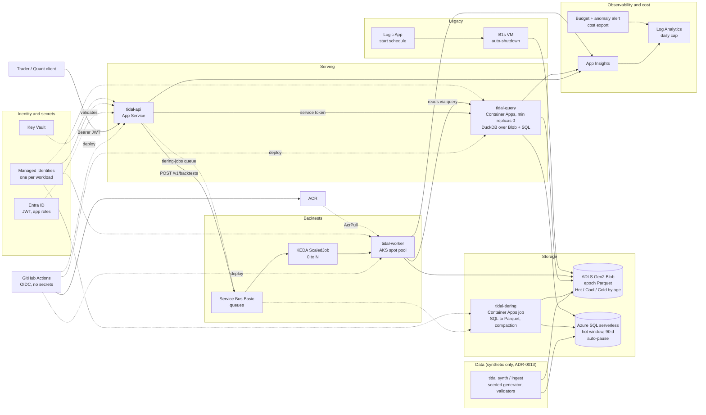

# Tidal: a cost-optimised time-series platform for front-office trading, on Azure

Tidal stores 20+ years of energy and commodity price history in an epoch Parquet format with hot/cold tiering,
serves it through an Entra ID-secured API, and runs backtests at scale on AKS with queue-driven autoscaling (KEDA).
Every cost claim is tied to a number in [`docs/finops/`](docs/finops/).

**This is a portfolio project. All data is synthetic** (seeded generator, [ADR-0013](docs/adr/0013-synthetic-only-data.md)),
including the negative WTI price of 2020-04-20. **Nothing has been deployed to Azure yet.** The Terraform, Helm and
pipelines are written, reviewed and validated in CI. Cloud numbers are pending a dev deployment and are labelled
NEEDS-CLOUD below.

## Results

Labels: **MEASURED** = counted by a run (local stack only so far). **MODELLED** = list price x measured or stated
quantity. **NEEDS-CLOUD** = needs a deployed environment and a real bill. No EUR figure is an invoice.

* A month with about 40 hours of real use is modelled at EUR 68.40 to 126.86 with the database at list price
  (EUR 54.44 to 82.61 on the free database offer). Parked outside those hours: EUR 46.61 (EUR 42.76 on the free offer).
  MODELLED.
* The EUR 60 active-month target is met only with the free SQL offer and parking outside work hours.
* The biggest savings come from compute that is switched off, not from clever storage. The epoch format is 3.6x smaller
  (MEASURED) but worth cents.

### Cost optimisation, before to after (C1 to C10)

EUR/month unless stated. Saving % = 1 - after / before. Copied from
[`docs/finops/cost-optimization.md`](docs/finops/cost-optimization.md), which is generated by script from
`docs/finops/prices.yaml`.

| # | Baseline | Optimised | Metric | Before -> after | Saving | Label |
|---|---|---|---|---|---|---|
| C1 | F0 SQL rowstore | F5 epoch Parquet | bytes at rest, S-3m slice (2,243,908 ticks) | 98.35 -> 27.10 MiB | 72.4 % | MEASURED |
| C1 | F0 (extrapolated) | F5 measured | EUR/month at rest, full S (50,083,533 ticks) | 0.2581 -> 0.0101 | 96.1 % | MODELLED (F5 bytes MEASURED) |
| C2 | all history in SQL GP 2 vCore | 90 d hot in serverless SQL + rest on Blob (S) | EUR/month | 215.20 -> 89.83 | 58.3 % | MODELLED, NEEDS-CLOUD |
| C2 | all rows in local SQL | after `tidal tiering run` | `md.tick_hot` reserved KB (local) | 71,368 -> 2,184 | 96.9 % | MEASURED (local) |
| C3 | all Hot (L) | Hot/Cool/Cold by `age_band`, ticks only, 2 tags | EUR/month incl. tags and compaction reads | 0.2580 -> 0.1472 | 43.0 % | MODELLED, tier capacity NEEDS-CLOUD |
| C4 | 5 x D4as_v5 on demand 24/7 | KEDA ScaledJob 0..N on spot, light / heavy | EUR/month compute | 667.95 -> 1.63 / 6.12 | 99.8 % / 99.1 % | MODELLED, NEEDS-CLOUD |
| C5 | query service on always-on B2 | Container Apps, min replicas 0 | EUR/month | 23.14 -> 0.00 (inside free grants) | 100.0 % | MODELLED, NEEDS-CLOUD (p95 cold start) |
| C6 | provisioned GP 2 vCore | serverless 0.5-2 vCore, pause 60 min (40 active h) | EUR/month | 218.91 -> 13.95 - 44.25 | 93.6 % - 79.8 % | MODELLED, NEEDS-CLOUD (resume latency) |
| C7 | B1s 24/7 | auto-shutdown + scheduled start | EUR/month | 9.85 -> 2.16 | 78.0 % | MODELLED, NEEDS-CLOUD |
| C8 | default diagnostics, uncapped (assumed 0.5 GB/day / 1 GB/day) | 0.2 GB/day cap + 20 % sampling | EUR/month | 26.31 / 65.78 -> 2.63 | 90.0 % / 96.0 % | MODELLED, NEEDS-CLOUD |
| C9 | no purge (month 6 / 12) | weekly `acr purge` | EUR/month | 4.40 / 9.68 -> 0.00 | 100.0 % | MODELLED, NEEDS-CLOUD |
| C10 | env always on | `make park` outside work hours / fully parked | EUR/month | 66.72 -> 36.95 / 24.38 | 44.6 % / 63.5 % | MODELLED, NEEDS-CLOUD |

Read with care:

* C4 node-hours (40 / 150 spot hours), 40 active SQL hours and the uncapped log rates are assumptions, not measurements.
* Each saving has a cost. Scale-to-zero (C5) and auto-pause (C6) add a cold-start and a resume delay, spot (C4) can be
  evicted, and the serverless database stops saving money above 426 active hours a month. The trade-offs, and what
  would change the conclusions, are in the report.
* Defender for SQL and private networking are off in dev to save EUR 13.20 and EUR 24.95 per month. Production would
  turn them on.
* Storage tiering (C3) nets cents. It is a design-correctness point, not a budget lever.

Storage benchmark (T-204, same synthetic ticks, SQL formats on a 3-month slice): F5 Parquet is 12.66 B/tick versus
45.96 B/tick for the SQL rowstore (MEASURED). Full report:
[`storage-benchmark-2026-10-22.md`](docs/finops/results/storage-benchmark-2026-10-22.md). Timing ratios are indicative
only (timing reproducibility FAILED the 15 % check; size reproducibility passed).

### Monthly totals (re-summed by script, `docs/finops/cost-model.md`)

| | Active low | Active high | Parked |
|---|---:|---:|---:|
| Total, SQL at list price | 68.40 | 126.86 | 46.61 |
| Total, SQL on the free offer (ADR-0011) | 54.44 | 82.61 | 42.76 |
| Parked, `enable_app_service=false` | | | 35.08 |

## Architecture

Source: [`docs/img/architecture.md`](docs/img/architecture.md). It shows what the Terraform in
`infra/terraform/envs/dev` and the Helm chart in `deploy/helm/tidal` describe, not a running system.



## Quickstart (local, no Azure account)

Needs Docker, Python 3.12 and [uv](https://docs.astral.sh/uv/).

```bash
uv sync                                  # install dependencies
cp .env.example .env                     # then set a strong TIDAL_SQL__PASSWORD
docker compose up -d                     # Azurite, SQL Server 2022, Service Bus emulator
docker compose --profile app up -d       # optional: also build and start tidal-api and tidal-query
uv run pytest -m "not integration"       # fast tests, no Docker needed
uv run pytest -m integration             # integration tests, need the compose stack
```

Other entrypoints (see `make help`): `make check` (ruff + mypy --strict), `make bench` (storage benchmarks),
`make contracts` (regenerate JSON schemas). `make tf-plan` and `make cost-report` are stubs today. The `api` and `query`
services sit behind the `app` compose profile and run with auth disabled, which is local-only. The worker has no
compose service yet. Details: [`deploy/local/README.md`](deploy/local/README.md).

## How it maps to the job requirements

| Requirement | Where in the repo | State |
|---|---|---|
| Epoch time-series format, 20+ years of history | `src/tidal/storage/`, [SPEC-02](docs/specs/SPEC-02-storage-format.md), [ADR-0004](docs/adr/0004-storage-format-tiering.md) | Built, C1 MEASURED locally |
| Hot/cold tiering, SQL to object storage | `src/tidal/storage/tiering*`, [SPEC-03](docs/specs/SPEC-03-tiering.md), ADR-0014, ADR-0015 | Built; crash-recovery and hot+cold equivalence tests pass in CI |
| Secure API (Entra ID, RBAC) | `src/tidal/api/`, [SPEC-06](docs/specs/SPEC-06-security.md) | Built; role matrix tested with local JWKS; live Entra NEEDS-CLOUD |
| Backtests at scale, queue-driven autoscaling | `src/tidal/backtest/`, `src/tidal/worker/`, `deploy/helm/tidal`, [SPEC-05](docs/specs/SPEC-05-backtest.md) | Code and IaC done; 0 to N run NEEDS-CLOUD |
| Several Azure compute targets | AKS, Container Apps, App Service, one legacy VM ([ADR-0002](docs/adr/0002-compute-targets.md)) | Terraform written, not applied |
| Infrastructure as code | `infra/terraform/` (modules + `envs/dev`) | validate, tflint, checkov pass in CI |
| CI/CD with OIDC | `.github/workflows/` | Pipelines merged; no cloud run yet |
| FinOps, with before/after numbers | `docs/finops/` | Above; cloud confirmation NEEDS-CLOUD |
| Observability | `modules/monitoring`, [SPEC-10](docs/specs/SPEC-10-observability.md) | Workbook and alerts in IaC |

## Design decisions

All ADRs are in [`docs/adr/`](docs/adr/README.md). The ones that shape the system:

* [ADR-0001](docs/adr/0001-contracts-first.md): contracts first; anything crossing a module boundary is defined in `docs/contracts/`.
* [ADR-0002](docs/adr/0002-compute-targets.md): which workload runs on which Azure compute target, and why.
* [ADR-0003](docs/adr/0003-servicebus-basic.md): Service Bus Basic, to keep the idle cost at about zero.
* [ADR-0004](docs/adr/0004-storage-format-tiering.md): storage format and tiering. Archive tier excluded for market data.
* [ADR-0008](docs/adr/0008-threat-model.md): threat model, 26 accepted dev residual risks, 13 production deltas.
* [ADR-0011](docs/adr/0011-azapi-sql-free-offer.md): SQL free offer in dev, set through azapi.
* [ADR-0013](docs/adr/0013-synthetic-only-data.md): synthetic data only.
* [ADR-0014](docs/adr/0014-tiering-versioning.md) and [ADR-0015](docs/adr/0015-minimal-index-tags.md): restatement versioning, and two index tags instead of five after the tag cost turned tiering into a net loss.
* [ADR-0016](docs/adr/0016-worker-reads-via-query.md): workers read data through `tidal-query`.

Principles: UTC int64 epoch nanoseconds internally, negative prices are valid and never clamped, no secrets in code
(Managed Identity, Key Vault, GitHub OIDC), deterministic seeded numerics. See [`CLAUDE.md`](CLAUDE.md).

## Gate status

Checked by the orchestrator against `main` with no Azure access. Notes are in [`docs/status/`](docs/status/).

| Gate | Scope | Status | Note |
|---|---|---|---|
| G0 | Foundation | PASS (bootstrap apply NEEDS-CLOUD) | CI green, contracts tagged `contracts-v1`, branch protection verified |
| G1 | Data core, infra base, API on fakes | PASS locally; Terraform plan/apply NEEDS-CLOUD | S-scale synthetic data (73.9M rows incl. bars) generated in 188 s; 20 years of daily history ingested locally |
| G2 | Storage and query | PASS (local) / NEEDS-CLOUD | Benchmark done; migration idempotent under kill tests; hot+cold equals pure SQL. Scale M not run |
| G3 | Backtests on AKS | NEEDS-CLOUD | Code complete; the 100-job 0 to N to 0 run needs Azure |
| G4 | Security | PASS (dev, with conditions) | Gitleaks clean on full history; admin routes not implemented; RBAC drift check NEEDS-CLOUD |
| G5 | FinOps and observability | PARTIAL | C1 to C10 each have a number and label; only C1 and C2 (local) are MEASURED; budget and anomaly alerts PASS in Terraform |
| G6 | Portfolio-ready | In progress | Wave 6: README, diagram, runbooks, demo |

## Repo map

```
src/tidal/       common, contracts, ingest, storage, query, api, worker, backtest, finops
benchmarks/      storage-format and query benchmarks
infra/terraform/ modules/* and envs/dev (never applied from automation)
deploy/          docker/, helm/tidal (KEDA ScaledJob), local/ (compose support)
docs/            PLANNING, specs, contracts, adr, finops, runbooks, status
tests/           unit, contract, integration, load
scripts/         park.sh, unpark.sh, rbac-export.sh, protect-main.sh
```

CLI entrypoints: `tidal`, `tidal-api`, `tidal-query`, `tidal-worker`, `tidal-tiering`.

## Runbooks and documentation

* Runbooks: [bootstrap](docs/runbooks/bootstrap.md), [deploy](docs/runbooks/deploy.md), [images](docs/runbooks/images.md),
  [park](docs/runbooks/park.md), [integration tests](docs/runbooks/integration-tests.md)
* Cost: [`cost-optimization.md`](docs/finops/cost-optimization.md), [`cost-model.md`](docs/finops/cost-model.md),
  [C1 to C3](docs/finops/results/c1-c3.md), [C4 to C10](docs/finops/results/c4-c10.md)
* Plan and rules: [`docs/PLANNING.md`](docs/PLANNING.md), [`docs/tasks/TASKS.md`](docs/tasks/TASKS.md),
  [`docs/business-knowledge.md`](docs/business-knowledge.md), [`docs/LOCAL-DEV.md`](docs/LOCAL-DEV.md)
* Contracts: [`docs/contracts/`](docs/contracts/); specs: [`docs/specs/`](docs/specs/)

## Limitations

* Nothing is deployed. Every cloud figure is MODELLED or NEEDS-CLOUD until a dev window turns them into MEASURED
  (checklist at the end of the cost report).
* Local request latency (median 91 ms, 89 requests) is a warm-laptop reference, not a cloud result.
* `/v1/admin/*` is in the OpenAPI contract but not implemented; `/v1/admin/storage/stats` has no stats source.
* Ingest does not emit telemetry yet, so the ingest-freshness alert is off.
* Dev has public data-plane endpoints, Defender for SQL off, and no private networking (all priced in the cost report).
* Synthetic data only. No vendor feed is connected.
