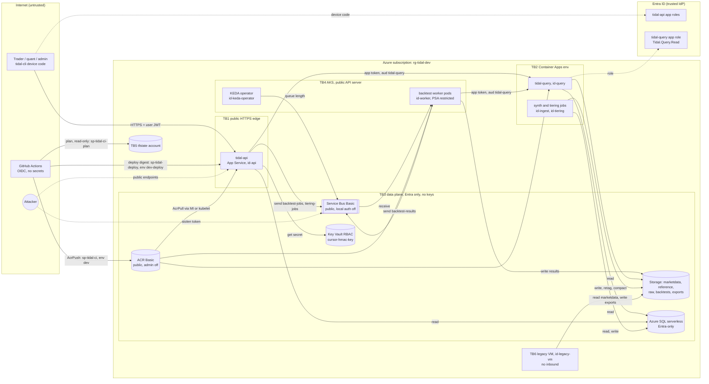

# ADR-0008: Threat model (STRIDE) for the dev environment

- Status: Accepted
- Date: 2026-10-24
- Deciders: Müge Güçlü (+ security-reviewer)
- Related: SPEC-06 (all sections, §7 sign-off), SPEC-04, SPEC-07, ADR-0002, ADR-0006, ADR-0011 to ADR-0018, T-401 to T-407,
  `docs/status/2026-W43-G4.md`

## Context
Wave 4 merged Entra auth (T-401/T-402), the RBAC matrix and drift check (T-403), private networking behind a flag (T-404),
supply-chain hardening (T-405) and SQL auditing (T-407). This record is the STRIDE review of the system as merged on `main`
at `e848c39`. It also collects the residual risks that earlier reviews deferred, so that they are accepted on purpose and not
by omission. Scope: the `dev` environment of a portfolio project with **synthetic data only** (ADR-0013). Nothing is deployed
yet, so every statement is about code, IaC and pipelines; live behaviour is NEEDS-CLOUD.

## Options
1. **STRIDE per trust boundary, with an explicit dev risk register.** One table per boundary, each threat linked to the file
   or ADR that mitigates it. One review, €0.
2. **Attack trees per asset.** Deeper on single assets, harder to keep in sync with the IaC.
3. **No written model; rely on per-PR reviews.** Deferred items then live in old PR threads and nobody accepts them.

## Decision
Option 1. The boundaries match the deployables (ADR-0002) and the identities (SPEC-06 §2), so each threat maps to one module
or router that a reviewer can open.

## System context and data flow

Trust boundaries: **TB1** Internet to `tidal-api`; **TB2** service-to-service calls into `tidal-query`; **TB3** workloads to
the Azure data plane; **TB4** the AKS cluster (pods, KEDA, API server); **TB5** CI/CD and the Terraform control plane;
**TB6** the legacy VM and its Logic App starter.

## Assets

| Asset | Sensitivity in dev | Where | Protection summary |
|---|---|---|---|
| Market data (synthetic, ADR-0013) | Low confidentiality, **high integrity** (backtests depend on it) | `marketdata`, `reference` containers; SQL `md`, `ref` | Entra-only data plane, soft delete 7 d, writers limited to id-ingest and id-tiering |
| Backtest results and job rows | Medium (strategy parameters per owner) | `backtests` container; SQL `ops.backtest_job` | owner hash check on read (`src/tidal/api/routers/backtests.py:354`), lifecycle delete at 365 d |
| `cursor-hmac-key` | High (forged cursors) | Key Vault | write-only ARM secret, never in state (`infra/terraform/envs/dev/rbac.tf:82-104`); Secrets User for id-api only |
| Identities: 6 workload MIs, KEDA MI, 3 GitHub apps, 2 Entra app registrations | High | Entra | no client secret or certificate anywhere; one federated subject per CI app |
| CI/CD pipeline | High (a path to every runtime) | `.github/workflows/*`, GitHub environments `dev`, `dev-deploy` | SHA-pinned actions, per-job `id-token`, digest deploys, environment gates (human setup) |
| Terraform state | Medium (resource IDs, sensitive outputs such as the App Insights connection string; no secret values thanks to write-only attributes) | bootstrap storage account | shared key off, Entra only, versioned, `CanNotDelete` lock; read by `sp-tidal-ci-plan` and the human applier only |
| Container images | High (they run as every workload identity) | ACR | trivy vuln + secret gate, SBOM, optional provenance attestation, digest-pinned deploys |

## STRIDE per boundary

"Owner" is the task that implemented the mitigation, or the follow-up that closes the residual risk. "R-n" points to the
accepted residual risk register below. Paths are relative to the repository root.

### TB1: Internet to tidal-api (App Service)

| STRIDE | Threat | Mitigation (where) | Residual | Owner / follow-up |
|---|---|---|---|---|
| S | Forged or replayed JWT; token for another app; app-only token used as a user | RS256 only, `kid` from cached JWKS, `iss`/`tid`/`aud`/`exp`/`nbf`/`oid` required (`src/tidal/api/auth.py:159-181`); `scp=access_as_user` and `azp` in the client allowlist (`auth.py:222-233`); 43 tests in `tests/unit/api/test_auth.py` | a stolen user token is valid until it expires (about 1 h) | T-402 |
| S | Dev JWKS, static cursor key or disabled auth reaches Azure | `TIDAL_AUTH__JWKS_URL` and `TIDAL_CURSOR__KEY` refused outside `local` (`src/tidal/common/config.py:304-307`, test `test_jwks_url_and_cursor_key_refused_outside_local`); `TIDAL_AUTH__DISABLED` only in local (`src/tidal/api/deps.py`, `assert_auth_allowed`) | R-8 | T-402, ADR-0012 |
| T | Tampered pagination cursor | HMAC-signed cursors bound to route and owner (`src/tidal/api/pagination.py`, `routers/backtests.py:326`); key from Key Vault, at least 32 bytes, fail closed (`auth.py:389-417`) | R-7 | T-402 |
| R | Caller denies a submission | structlog JSON with `correlation_id`, `principal_oid` hashed (`src/tidal/common/logging.py`); job row stores `owner_hash` | App Insights export not wired in Azure (R-21) | T-505 |
| I | Reading the backtest of another user (IDOR) | `GET` returns 404 unless `owner_hash` matches and the job is a parent (`routers/backtests.py:354`); list filtered by owner (`:324-328`) | none known | T-304 |
| I | Tokens or PII in logs | tokens never logged, one generic rejection message (`auth.py:41`); oid hashed (`common/logging.py:76`) | the oid hash is unsalted SHA-256: not reversible in practice, but linkable across log sinks | nit, T-505 |
| D | Request flood, sweep fan-out | 60 req/min per principal (`src/tidal/api/ratelimit.py`), sweep max 200 children, range limits with 413 (SPEC-04 §3); a single B1 instance caps cost | per-instance limiter (R-22); no Idempotency-Key (R-5) | T-111 |
| E | Reader submits backtests; trader uses admin | `require_role` on every non-health route (`src/tidal/api/auth_roles.py`, `src/tidal/api/routers/*.py`); unknown roles dropped (`auth.py:233`); matrix tests (`test_auth.py:146-172`, `tests/unit/api/test_routers_market.py:413-431`); `app_role_assignment_required = true` (`infra/terraform/modules/entra_app/main.tf:76`) | `/v1/admin/*` is in the contract but not implemented (R-20) | T-402; R-20 |

### TB2: callers to tidal-query (Container Apps)

| STRIDE | Threat | Mitigation (where) | Residual | Owner / follow-up |
|---|---|---|---|---|
| S | Any Entra principal in the tenant calls tidal-query | router-level auth dependency on every route (`src/tidal/query/service.py:231`); `EntraTokenValidator` needs `idtyp=app`, no `scp`, role `Tidal.Query.Read`, and `azp` or `oid` in an allowlist (`auth.py:236-274`); an empty allowlist is a startup error; `app_role_assignment_required = true` (`modules/entra_app/main.tf:155`) | depends on the `idtyp` optional claim (`modules/entra_app/main.tf:136-141`); if Entra omits it every call fails closed (R-12) | T-402 |
| T | MITM between api and query | HTTPS only, `allow_insecure_connections = false` (`infra/terraform/modules/container_apps/main.tf:63`); internal ingress when the flag is on (T-404) | flag off: external ingress, protected by token validation only (R-25) | T-309, T-404 |
| I | Worker reads SQL directly | the worker has no SQL role and reads through tidal-query (ADR-0016) | none | T-303 |
| D | Unbounded scans | same range limits as the API (`check_*_range` in `query/service.py`); max replica count | cost spike up to the max replica count | T-309 |
| E | User token replayed at tidal-query | delegated tokens (`scp` present or `idtyp != app`) rejected (`auth.py:265`) | none | T-402 |

### TB3: workloads to the data plane (Storage, SQL, Service Bus, Key Vault, ACR)

| STRIDE | Threat | Mitigation (where) | Residual | Owner / follow-up |
|---|---|---|---|---|
| S | Shared keys, SAS or SQL logins | `shared_access_key_enabled = false`, `default_to_oauth_authentication = true`, `local_user_enabled = false` (`infra/terraform/modules/storage/main.tf:27-33`); `local_auth_enabled = false` (`modules/servicebus/main.tf:35`); `azuread_authentication_only = true`, no admin login (`modules/sql/main.tf:9,33`); ACR `admin_enabled = false`, `anonymous_pull_enabled = false` (`modules/acr/main.tf:56-61`); Key Vault RBAC mode (`modules/key_vault/main.tf:20`); credential pinned to the user-assigned MI, never `DefaultAzureCredential` (`auth.py:340-356`) | none | T-121 to T-126, T-402 |
| S | Stolen Service Bus token used from the Internet | RBAC per queue, TLS 1.2 (ADR-0006) | R-16 | ADR-0006 |
| T | Tampering with or deleting market data | writers: id-ingest (Blob Data Contributor), id-tiering (Blob Data Owner on `marketdata` only); blob and container soft delete 7 d (`modules/storage/main.tf:45-50`); `allow_nested_items_to_be_public = false` | versioning is off by design; no alert on SetBlobTags, DeleteBlob or managementPolicies writes (R-2); Data Owner breadth (R-23) | T-403, T-506 |
| R | No audit trail of data access | SQL server auditing to Log Analytics (ADR-0017, `modules/sql/auditing.tf`); Azure Activity Log for the control plane | no storage diagnostic logs or alerts (R-2); Defender off (R-13) | T-407, T-506 |
| I | Exfiltration through public endpoints | Entra-only data plane; with `enable_private_networking` Storage, SQL and Key Vault get private endpoints and public access off (`modules/storage/main.tf:38`, `modules/sql/main.tf:6`, `modules/key_vault/main.tf:27`, `modules/network`) | open egress (R-15); the flag is off by default (R-25) | T-404 |
| I | Secrets in app settings or state | app settings validation rejects secret-like names and `sig=`, `AccountKey=`, `SharedAccessKey=` values (`modules/app_service/variables.tf:132`, `modules/container_apps/variables.tf:75`); Key Vault secrets written through write-only `sensitive_body` (`envs/dev/rbac.tf:60-124`) | sensitive outputs in state (R-24) | T-309, T-403 |
| T | Forged or replayed backtest results; job records tampered with (T-606/T-607) | only id-worker sends to `backtest-results` (`envs/dev/rbac.tf:253`); the in-API aggregator dead-letters oversized, malformed and unknown-job results (`src/tidal/api/aggregator.py`); `finish_child` applies the first terminal result only; id-api holds `SELECT, INSERT, UPDATE` on `ops.backtest_job` and no DELETE (`docs/rbac/sql-grants.sql`); results carry `result_sha256` of deterministic outputs | a compromised worker can report false metrics; a compromised API can rewrite job status and metrics | R-28 |
| D | Queue flooding; KEDA scaling to max | only id-api sends to `backtest-jobs`; ScaledJob max replicas and namespace ResourceQuota (`deploy/helm/tidal/templates/resourcequota.yaml`); spot pool max 10 nodes (SPEC-07) | a cost ceiling, not a hard stop; budget alerts in Wave 5 | T-307 |
| E | A workload gains wider roles | one MI per workload, roles scoped to container, queue or secret (`envs/dev/rbac.tf`, SPEC-06 §2); nightly drift diff (`scripts/rbac-export.sh`, `rbac-drift` in `.github/workflows/iac.yml`) | the drift job is non-required and needs cloud; SQL grants are not exported | T-403 |

### TB4: AKS cluster

| STRIDE | Threat | Mitigation (where) | Residual | Owner / follow-up |
|---|---|---|---|---|
| S | kubeconfig admin credentials | `local_account_disabled = true`, Entra + Azure RBAC (`infra/terraform/modules/aks/main.tf:29-33`) | public API server, authorized IPs opt-in (R-3) | T-306 |
| T | Container escape, host access | PSA `restricted` enforced on namespace `tidal` (`deploy/helm/tidal/templates/namespace.yaml`); `runAsNonRoot`, UID 10001, `readOnlyRootFilesystem`, drop ALL, no privilege escalation, seccomp; no `privileged` or `hostPath` (rendered chart, kube-linter and kubeconform clean, see the G4 note); image `USER 10001` (`deploy/docker/Dockerfile:83,99`) | chart lint in CI (closed R-19); namespace created with PSA labels by the applier (closed R-26) | T-305, T-307 |
| I | Pod steals node identity through IMDS | default-deny NetworkPolicy, egress DNS + 443 only, `169.254.169.254/32` excluded (`deploy/helm/tidal/templates/networkpolicy.yaml`); `automountServiceAccountToken: false`; workload identity federated per service account | 443 to any other address (R-15) | T-307 |
| D | Spot eviction, runaway jobs | `activeDeadlineSeconds`, `backoffLimit: 0`, Service Bus max delivery 3 + DLQ | none for security | T-307 |
| E | KEDA identity abused | `id-keda-operator` federated only to `kube-system:keda-operator`, Data Owner on `backtest-jobs` only | Data Owner can also send to and manage that queue (R-23) | T-403 |

### TB5: CI/CD and the Terraform control plane

| STRIDE | Threat | Mitigation (where) | Residual | Owner / follow-up |
|---|---|---|---|---|
| S | Fork PR obtains a cloud token | no `pull_request_target` in any workflow; OIDC subjects `environment:dev` and `environment:dev-deploy` only (`infra/terraform/bootstrap/main.tf:135-149`, `envs/dev/rbac.tf`); `id-token: write` per job; fork PRs skip the plan job (`iac.yml`, `head.repo.full_name` guard) | environment policies are human setup (R-9) | T-008, T-403 |
| T | Malicious image pushed and deployed | trivy vuln (HIGH/CRITICAL, fixable) and secret scan before push (`.github/workflows/images.yml:102-118`); image ID re-checked after the scan (`images.yml:121-128`); deploy by digest only (`.github/workflows/deploy.yml`); base images pinned by digest (`Dockerfile:16,19,47`) | no signing or admission check; any AcrPush holder can push any tag (R-17) | T-308, T-311, T-405 |
| T | Compromised third-party action | every `uses:` in the 8 workflows pinned to a 40-hex SHA (checked for this review); Dependabot weekly with a 7-day cooldown (`.github/dependabot.yml`) | R-10 | T-405 |
| T | CI rewrites infrastructure or the lifecycle policy (T-207 concern) | `sp-tidal-ci` holds AcrPush only, no RG Contributor (SPEC-06 §2, `envs/dev/rbac.tf:267-270`, `docs/rbac/expected.json`); no state role (`bootstrap/main.tf:148-149`); `terraform apply` is human-only | R-1 | T-403 |
| I | Plan identity reads state | `sp-tidal-ci-plan` is Reader + Storage Blob Data Reader (`docs/runbooks/bootstrap.md:13`); write-only secrets keep values out of state | PR authors can read it with the plan token (R-27); R-24 | R-27 |
| R | Untracked rights changes | `rbac-drift` nightly diff; every assignment carries a description (`envs/dev/rbac.tf`) | non-required, needs cloud | T-403 |
| E | The deploy SP becomes any target identity | `sp-tidal-deploy` scoped per resource; `dev-deploy` allows `main` only with a required reviewer (`docs/runbooks/deploy.md:51-67`) | Managed Identity Operator grants the union of the rights of all target identities (R-6) | T-403 |
| E | Secrets committed | gitleaks in pre-commit and CI (`ci.yml`, gitleaks job); a full-history scan for this review found 0 leaks | none | T-405 |

### TB6: legacy VM and Logic App

| STRIDE | Threat | Mitigation (where) | Residual | Owner / follow-up |
|---|---|---|---|---|
| S | SSH brute force | no inbound Allow rule on either NSG (`infra/terraform/modules/vm_legacy/tests/nsg.tftest.hcl`, `modules/network/tests/network.tftest.hcl`); password auth off, key only (`modules/vm_legacy/main.tf:136-144`); no extensions (`:137`) | outbound-only Standard public IP in private mode (R-14) | T-310, ADR-0018 |
| T | VM writes market data | id-legacy-vm: Reader on `marketdata`, Contributor on `exports` only (SPEC-06 §2) | none | T-310 |
| E | VM starts or changes other resources | custom role `vm-self-deallocate` on its own VM only; start runs as a separate Logic App system identity (`modules/vm_legacy/main.tf:201-235`) | none | T-310 |
| I | Exfiltration from the VM | nothing beyond the NSG, which allows TCP 80/443 out to Internet (`modules/network/README.md`) | R-15 | T-404 |

## Accepted residual risks (dev)

Accepted for `dev` only: synthetic data (ADR-0013), no customers, a budget of about 61-114 EUR/month active. Each risk has an
owner and a trigger that reopens it. Items 1-14 are the deferred findings of earlier reviews; 15-17 come from
`infra/terraform/modules/network/README.md` (section "For T-406 threat model"); 18-26 are new in this review.

| # | Risk | Why accepted in dev | Owner / follow-up |
|---|---|---|---|
| R-1 | CI could once rewrite infrastructure and the lifecycle policy (T-207 review). **Mitigated:** `sp-tidal-ci` is AcrPush only (SPEC-06 §2, `envs/dev/rbac.tf:267-270`, `docs/rbac/expected.json`) and holds no state role. **Closed by T-506:** activity-log alerts on lifecycle policy, role assignment, storage account, key listing, immutability, diagnostic setting, alert rule and action group changes, plus a blob audit alert for unexpected or non-OAuth callers. Residual: a compromised Owner can delete the alert rules (the delete itself alerts, but the same caller can remove the action group first); the 90-day activity log remains the forensic trail | human-only applies by one person | none |
| R-2 | No alerts on `SetBlobTags`, `DeleteBlob`, `managementPolicies/write`; no storage diagnostic logs | soft delete 7 d gives a recovery window | T-506 |
| R-3 | The AKS API server is public; `api_server_authorized_ip_ranges` is opt-in; the cluster is not private | Entra-only auth, local accounts off; a private cluster needs a jump host or a self-hosted runner | P-3 |
| R-4 | Backtest blobs are deleted by lifecycle at 365 d (SPEC-03 §4), but the API has no `410 Gone` for expired results | availability only, no confidentiality impact | API follow-up (api-contract, SPEC-05) |
| R-5 | No `Idempotency-Key` on `POST /v1/backtests`: client retries duplicate jobs (cost amplification) | Quant only, rate limited, max 200 children per call | ADR follow-up listed in `docs/status/2026-W43-G3.md` |
| R-6 | `sp-tidal-deploy` holds the union of the rights of id-api, id-query, id-ingest and id-tiering through Managed Identity Operator | gated by `dev-deploy` (main only, required reviewer) | verify live; drop MIO where image-only updates do not need it (SPEC-06 §2) |
| R-7 | `cursor-hmac-key` rotation is manual (`cursor_hmac_version`), with no expiry and an API restart; `cursor-hmac-key-previous` is verify-only | the key never leaves Key Vault or process memory | P-8 |
| R-8 | The dev JWKS override and the static cursor key exist in code | refused by config validation outside `TIDAL_ENV=local`, with tests | none while the guard and its test stay |
| R-9 | The `dev` and `dev-deploy` environment policies (branches, reviewers) and the `v*` tag ruleset are human setup, not IaC. Unset, any branch could reach AcrPush or deploy | GitHub settings are outside the Terraform scope | checklists in `docs/runbooks/images.md` and `docs/runbooks/deploy.md` before the first apply; P-10 |
| R-10 | Compose and integration-test image digests are bumped by hand; the 7-day Dependabot cooldown delays urgent fixes | security updates bypass the cooldown once enabled in the repository settings | T-405 |
| R-11 | The `access_as_user` scope is Admin-consent type and `tidal-cli` is pre-authorised; the API client allowlist holds only `tidal-cli` (`envs/dev/entra.tf:55`) | no consent prompt is wanted; any new client needs an explicit allowlist entry | revisit when a second client exists |
| R-12 | tidal-query relies on the `idtyp` optional claim | fails closed: a missing claim rejects every call | verify live (NEEDS-CLOUD) |
| R-13 | Defender for SQL and VA are off by default (ADR-0017) | cost for synthetic data; server auditing is on | P-6 |
| R-14 | The VM NIC has an outbound-only Standard public IP in private mode (ADR-0018) | no inbound rule, tested; NAT costs about 29 EUR/month | P-2 |
| R-15 | Open egress: VM to Internet on 80/443; AKS pods on 443 to any address; App Service and Container Apps keep default egress. A compromised workload can exfiltrate to any HTTPS host | low impact with synthetic data | P-2 |
| R-16 | Service Bus is public: a stolen Entra token with a data role works from anywhere until it expires; only RBAC and TLS 1.2 protect the namespace (ADR-0006) | Premium (needed for a private endpoint) costs more than the queues are worth | P-4 |
| R-17 | ACR is public (Basic, no private link); no image signing or admission policy; any AcrPush holder can push an image that AKS, Container Apps or App Service pull | deploys are digest-pinned; AcrPush is only `sp-tidal-ci` behind environment `dev` | P-5 |
| R-18 | **Closed by T-408.** `sp-tidal-ci-plan` (Reader + state Storage Blob Data Reader, used by PR plans) was created by hand, invisible to `rbac-drift`. It is now in `infra/terraform/bootstrap`, in `docs/rbac/expected.json` and covered by the drift check; the drift job moved to its own app `sp-tidal-rbac-drift` | n/a | closed |
| R-19 | **Closed by T-409 (`.github/workflows/chart.yml`: helm lint, kubeconform strict with KEDA CRDs, kube-linter; chart test asserts no host access and hardening, fails instead of skipping in CI).** kube-linter and kubeconform run by hand only. The header of `deploy/helm/tidal/.kube-linter.yaml` and `docs/runbooks/images.md:51` say they run in CI, which is not true. `tests/unit/deploy/test_helm_chart.py` does not check `privileged`, `hostPath` or non-root, and skips without Docker | n/a | closed |
| R-20 | **Closed by T-410 (#84): `/v1/admin/*` implemented with HTTP role tests (Reader/Trader/Quant 403, Admin 2xx).** `/v1/admin/tiering/run` and `/v1/admin/storage/stats` are in `docs/contracts/openapi.yaml:374,393` but not implemented, and no task in `docs/tasks/TASKS.md` owns them. "Trader cannot call admin (403)" is proven only by `has_role` unit tests, not over HTTP | n/a | closed |
| R-21 | **Closed by T-608 (#100): `TIDAL_OTEL__CONNECTION_STRING` reaches both apps as a Key Vault reference (App Service `@Microsoft.KeyVault(...)`, Container Apps `key_vault_secret_id`), read by id-api/id-query with secret-scoped Secrets User.** Residual: resolution verified only offline (NEEDS-CLOUD) | — | — |
| R-22 | The rate limit is per process (N replicas give N times 60/min) | one B1 instance in dev | P-7 |
| R-23 | Broad data roles where narrower ones are unverified: id-tiering Data Owner on `marketdata` and on `tiering-jobs`; KEDA Data Owner on `backtest-jobs` | no documented narrower built-in role covers the needed actions | live custom-role test (`docs/rbac/README.md`) |
| R-24 | Terraform state holds sensitive outputs (App Insights connection string, output `tidal_config_sensitive`) | no keys; connection-string part closed by T-506 (App Insights local auth off, Entra token required); state is Entra-only and locked | P-12 |
| R-25 | With the flag off (dev default), App Service, tidal-query ingress, Storage, SQL and Key Vault are public endpoints, protected by Entra auth and TLS 1.2 only | no network cost; the flag is tested in T-404 | P-1 |
| R-26 | **Closed by #82: values-dev uses an externally managed namespace created by the applier with the PSA labels.** Namespace bootstrap conflict. `values.yaml` defaults to `namespace.create: true`, so the chart renders the cluster-scoped Namespace with the PSA `restricted` labels. But `docs/runbooks/deploy.md:70-76` has the human run a bare `kubectl create namespace tidal` (no PSA labels), and `sp-tidal-deploy` only holds RBAC Writer inside the namespace. The first `helm upgrade` in `deploy.yml` should then fail (Helm can neither adopt nor create the Namespace). The obvious workaround, `namespace.create=false` with `externallyManagedAck=true`, leaves a namespace **without** PSA enforcement, and the chart only trusts the acknowledgement | n/a | closed |
| R-27 | A same-repo PR author can use the `sp-tidal-ci-plan` token (subject `pull_request`) to read the full dev Terraform state and to make tenant-wide Microsoft Graph app reads (`Application.Read.All`, needed for the PR plan to refresh azuread resources). The state still holds: the App Insights connection string (`tidal_config_sensitive`), no longer usable for ingestion: App Insights local auth is off since T-506, so the string is not a credential; possibly inert storage account keys (verify after the first apply with `terraform state pull \| jq` over `.resources[].instances[].attributes` for `primary_access_key`/`connection_string`; shared keys are disabled so they should be unusable); and recon-only IDs (tenant, subscription, object and client IDs, resource names) | forks get no OIDC token, so same-repo write access is required, and the PR itself is reviewed; the app holds no write role; the drift job no longer shares this identity | verify state contents live (NEEDS-CLOUD); connection-string part closed by T-506 (local auth off) |
| R-28 | Since T-606/T-607 the API process holds SQL write on `ops.backtest_job` and receives `backtest-results`; a compromised API can rewrite job status and metrics, and anyone with id-worker's send right can forge a result for a known job id. R-5 (no `Idempotency-Key`) now persists duplicate jobs in SQL | narrow grant (no DELETE), first-terminal-wins update, result size and schema checks, one sender identity; results reference content-hashed outputs in `backtests/` | sign results or verify `result_sha256` against the blob on read (follow-up); Idempotency-Key ADR (R-5) |
| R-29 | The repository is public, so CI output is public: `iac.yml` writes the Terraform plan to the job summary and `cost.yml` publishes spend per resource ID; sensitive values are masked but subscription and resource IDs and costs are not | nothing is deployed yet, so no run has produced real values; forks get no OIDC token | before the first deploy: drop the plan from the job summary (artifact with short retention instead), redact `/subscriptions/<id>` in the cost report, or accept here explicitly |

**Count: 24 open accepted residual risks** (R-18 closed by T-408, R-19 by T-409, R-20 by T-410, R-21 by T-608, R-26 by #82; R-27 added; R-28 and R-29 added in T-604). R-1 is closed by T-506 (residual noted in its row).

## Production delta

What changes before any non-synthetic or production use:

- **P-1** `enable_private_networking = true` always: private endpoints for Blob, SQL and Key Vault; internal Container Apps
  ingress; App Service VNet integration with public access off, behind Front Door or Application Gateway with WAF.
- **P-2** Egress control: NAT gateway or Azure Firewall with FQDN allow lists for the VM, AKS (`userDefinedRouting`),
  Container Apps and App Service; no VM public IP (`network_vm_outbound = "nat_gateway"`).
- **P-3** Private AKS cluster (or mandatory authorized IPs) and self-hosted runners in the VNet for deploys.
- **P-4** Service Bus Premium with a private endpoint and public access off.
- **P-5** ACR Premium: private link, image signing (Notation) and an admission policy that only admits signed digests from
  the build pipeline; provenance attestation required (`IMAGE_ATTEST=true`).
- **P-6** Defender for SQL, Storage, Key Vault, Containers and Resource Manager on; SQL VA on (ADR-0017).
- **P-7** Distributed rate limiting (APIM or a shared store) and an `Idempotency-Key` contract.
- **P-8** Scheduled `cursor-hmac-key` rotation with overlap, Key Vault expiry notifications and Key Vault diagnostic logs.
- **P-9** Detection: storage and Key Vault diagnostic logs; Activity Log alerts on role assignments, `managementPolicies/write`
  and `DeleteBlob` bursts (T-506 baseline); App Insights wired (T-505); a SIEM sink.
- **P-10** GitHub environments, branch protection and tag rulesets as code; `rbac-drift` as a required check;
  `sp-tidal-ci-plan` in IaC.
- **P-11** Remove Managed Identity Operator from the deploy SP where image-only updates do not need it; one deploy identity
  per target.
- **P-12** Separate subscription and state account per environment; PIM for the human Owner role; documented break-glass.
- **P-13** Blob versioning or immutability on `marketdata` if real vendor data is ever ingested (reversal of ADR-0013).

## Consequences
- Every deferred review item now has a number, an owner and a reopening trigger. A PR that touches a boundary updates the
  matching table here.
- Four findings needed new tasks: R-18 (plan app into IaC, done in T-408), R-19 (chart lint in CI plus two wrong doc claims), R-20 (admin
  router) and R-26 (namespace bootstrap and PSA labels, before the first deploy). None is exploitable in dev today. R-20 leaves
  one half of a SPEC-06 §7 item unprovable over HTTP.
- Revisit when real data replaces synthetic data, a second API client is added, the flag default changes, or before any
  production subscription is created.
