# Storage format benchmark, 2026-10-22

_Generated by `benchmarks/storage/report.py` from the raw results Parquet. Every number is MEASURED (harness) or MODELLED (EUR = quantity x `docs/finops/prices.yaml`) and labelled so. Local run only; Azure runs are NEEDS-CLOUD._

## Executive summary

* **Smaller and cheaper to keep.** Tidal's epoch-optimised Parquet (F5) holds the S-3m dataset (2.2 million ticks) in 27.10 MiB: 3.6x smaller than the naive relational baseline F0 (3.6x after removing the extra column F0 needs for nanosecond accuracy) and 1.7x smaller than default Parquet. At list prices that is 25.4x lower monthly storage cost than F0 (24.9x adjusted), because the files also sit in the cheaper Blob tier (MEASURED bytes, MODELLED EUR).
* **Faster analytical reads.** On the same machine, warm queries over F5 are faster than F0 by these factors (F0 time / F5 time): 1.7x (W2), 5.6x (W3), 10.2x (W5), 2.0x (W6). W2 is daily bars, W3 a one-month range, W5 a ten-instrument scan, W6 an as-of query with restatements. The point lookup (W4) factor is 0.3x, where a clustered index is at its best. Local, in-process numbers, indicative only (timing reproducibility FAILED the 15 % tolerance): see the caveats.
* **Reads are cheap per query because most of the file is skipped.** A one-month range query on F5 reads 9.50 % of the stored bytes (the month-partitioned objects let the engine skip the rest) and, counted against Azurite, issues 5 GET + 7 HEAD + 1 LIST requests, about EUR 0.0093 of Blob transactions per 1,000 queries (MODELLED from MEASURED counts). Absolute Azure numbers are pending (local run only).

## Methodology

* Data: deterministic synthetic ticks (`tidal.ingest.sources.synthetic`, seed 42), one object per
  instrument-month, plus 1 % restatements (`version=2`) of one instrument-month for W6.
  scale S-3m: 2,243,908 base ticks, scale S: 50,083,533 base ticks.
* F0-F2 run on SQL Server 2022 (Docker, Developer edition); F3-F6 are files read by DuckDB, on the
  local file system for timings and additionally on Azurite (through a counting proxy) for real
  HTTP request counts and egress bytes. Candidates: SPEC-02 section 2, with the T-202/T-203
  deviations (F0 `ts_sub` column, F4 `timestamp[ns]`).
* Workloads W1-W6: SPEC-02 section 3. Every result of every format is checked against an
  independent polars oracle on every run; a mismatch aborts the run.
* 5 runs per cell (SQL W1: fewer, see the W1 table), p50 and p95 reported. cold = fresh connection
  (SQL also empties its buffer pool); warm = after one untimed priming run. W1 = fresh store/run.
* Bytes read: DuckDB profile (local Parquet), whole-file size (CSV), real HTTP response bytes
  (Azurite), SQL `STATISTICS IO` logical pages x 8 KiB. These measure different things; tables
  label the source class and the chart gives each class its own axis.
* At rest: Azure SQL bills the provisioned maximum data size and never less than what is
  allocated, so the SQL EUR column uses the table's allocated (reserved) pages, not used pages;
  Blob bills stored bytes. Allocated is the tightest basis one table measurement supports (real
  bills add system objects, the log and headroom), so SQL cost is if anything understated.
  F0 is shown raw and adjusted (minus the 1 byte/tick `ts_sub` that only exists for nanosecond
  exactness).
* EUR per 1,000 queries: Blob transactions from REAL Azurite request counts (GET/HEAD at the read
  meter, LIST at the write/list meter, in-region egress free). SQL has no per-operation meter, so
  its column is modelled compute (1 vCore busy for the wall time at the serverless rate).
  File-format compute (Container Apps) is excluded (C5); the families are therefore not directly
  comparable on this column, compare the time columns.

## Bytes per tick across scales

Used bytes at rest divided by the dataset's base ticks (restatements are included in the bytes, about 0.03 % of ticks). A format whose bytes/tick barely moves between scales can be compared across them.

| Format (used bytes / tick) | S-3m (2.2M ticks) | S (50.1M ticks) |
|---|---|---|
| F0 | 45.96 | n/a |
| F1 | 25.04 | n/a |
| F2 | 19.28 | n/a |
| F3 | 20.43 | 20.37 |
| F4 | 21.18 | 20.91 |
| F5 | 12.66 | 12.63 |

## Results, scale S-3m

### Storage at rest

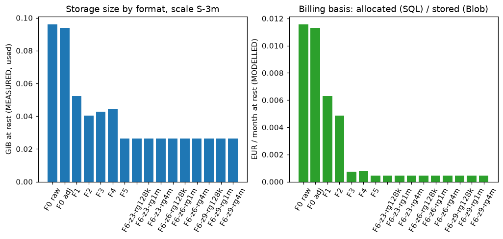

| Format | Bytes at rest (used) | B/tick | vs F5 (size) | Billed basis | EUR/month (MODELLED) | vs F5 (EUR) |
|---|---|---|---|---|---|---|
| F0 (raw) | 98.35 MiB | 45.96 | 3.6x | 98.38 MiB | 0.0116 | 25.4x |
| F0 (adjusted, no ts_sub) | 96.21 MiB | 44.96 | 3.6x | 96.24 MiB | 0.0113 | 24.9x |
| F1 | 53.58 MiB | 25.04 | 2.0x | 53.63 MiB | 0.0063 | 13.9x |
| F2 | 41.25 MiB | 19.28 | 1.5x | 41.38 MiB | 0.0049 | 10.7x |
| F3 | 43.72 MiB | 20.43 | 1.6x | 43.72 MiB | 0.0007 | 1.6x |
| F4 | 45.32 MiB | 21.18 | 1.7x | 45.32 MiB | 0.0008 | 1.7x |
| F5 | 27.10 MiB | 12.66 | 1.0x | 27.10 MiB | 0.0005 | 1.0x |
| F6-z3-rg128k | 27.05 MiB | 12.64 | 1.0x | 27.05 MiB | 0.0005 | 1.0x |
| F6-z3-rg1m | 27.04 MiB | 12.63 | 1.0x | 27.04 MiB | 0.0005 | 1.0x |
| F6-z3-rg4m | 27.04 MiB | 12.63 | 1.0x | 27.04 MiB | 0.0005 | 1.0x |
| F6-z6-rg128k | 27.11 MiB | 12.67 | 1.0x | 27.11 MiB | 0.0005 | 1.0x |
| F6-z6-rg1m | 27.10 MiB | 12.66 | 1.0x | 27.10 MiB | 0.0005 | 1.0x |
| F6-z6-rg4m | 27.10 MiB | 12.66 | 1.0x | 27.10 MiB | 0.0005 | 1.0x |
| F6-z9-rg128k | 27.03 MiB | 12.63 | 1.0x | 27.03 MiB | 0.0005 | 1.0x |
| F6-z9-rg1m | 27.01 MiB | 12.62 | 1.0x | 27.01 MiB | 0.0005 | 1.0x |
| F6-z9-rg4m | 27.01 MiB | 12.62 | 1.0x | 27.01 MiB | 0.0005 | 1.0x |

### W1 bulk write (one instrument)

| Format | Runs | p50 s | p95 s | rows/s | CPU s (client) | Size of the 1-instrument store |
|---|---|---|---|---|---|---|
| F0 | 1 | 674.827 | 674.827 | 1,390 | 3.3 | 41.08 MiB |
| F1 | 1 | 541.852 | 541.852 | 1,731 | 2.2 | 22.32 MiB |
| F2 | 1 | 605.644 | 605.644 | 1,549 | 2.2 | 17.22 MiB |
| F3 | 5 | 4.486 | 5.314 | 209,081 | 3.5 | 18.17 MiB |
| F4 | 5 | 1.099 | 1.835 | 853,831 | 0.7 | 18.54 MiB |
| F5 | 5 | 0.574 | 0.934 | 1,633,804 | 0.4 | 11.26 MiB |
| F6-z3-rg128k | 5 | 0.309 | 0.472 | 3,036,505 | 0.2 | 11.22 MiB |
| F6-z3-rg1m | 5 | 0.454 | 0.671 | 2,064,364 | 0.2 | 11.23 MiB |
| F6-z3-rg4m | 5 | 0.414 | 0.559 | 2,268,431 | 0.3 | 11.23 MiB |
| F6-z6-rg128k | 5 | 0.735 | 0.764 | 1,275,663 | 0.5 | 11.27 MiB |
| F6-z6-rg1m | 5 | 0.682 | 0.754 | 1,376,157 | 0.4 | 11.26 MiB |
| F6-z6-rg4m | 5 | 0.541 | 1.365 | 1,733,790 | 0.4 | 11.26 MiB |
| F6-z9-rg128k | 5 | 0.907 | 1.069 | 1,033,767 | 0.5 | 11.22 MiB |
| F6-z9-rg1m | 5 | 0.934 | 1.087 | 1,004,598 | 0.5 | 11.21 MiB |
| F6-z9-rg4m | 5 | 1.103 | 1.363 | 850,788 | 0.5 | 11.21 MiB |

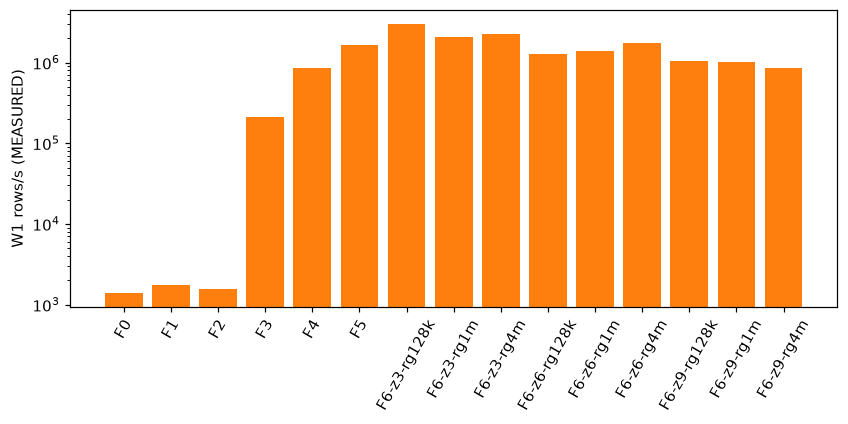

### Query latency, p50 seconds

Warm:

| Format | W2 | W3 | W4 | W5 | W6 |
|---|---|---|---|---|---|
| F0 | 0.114 | 0.125 | 0.014 | 0.414 | 0.463 |
| F1 | 0.158 | 0.208 | 9.8 ms | 0.936 | 0.274 |
| F2 | 21.298 | 0.028 | 0.012 | 0.052 | 0.305 |
| F3 | 1.129 | 0.231 | 0.605 | 1.762 | 1.063 |
| F4 | 0.074 | 0.032 | 0.046 | 0.063 | 0.261 |
| F5 | 0.067 | 0.022 | 0.042 | 0.040 | 0.228 |

Cold (fresh connection; see the cold_mode table):

| Format | W2 | W3 | W4 | W5 | W6 |
|---|---|---|---|---|---|
| F0 | 0.424 | 0.154 | 0.024 | 0.735 | 0.640 |
| F1 | 0.316 | 0.146 | 0.030 | 0.802 | 0.350 |
| F2 | 21.895 | 0.171 | 0.085 | 0.303 | 0.404 |
| F3 | 0.704 | 0.260 | 0.748 | 1.624 | 1.026 |
| F4 | 0.093 | 0.029 | 0.040 | 0.057 | 0.284 |
| F5 | 0.057 | 0.023 | 0.039 | 0.052 | 0.328 |

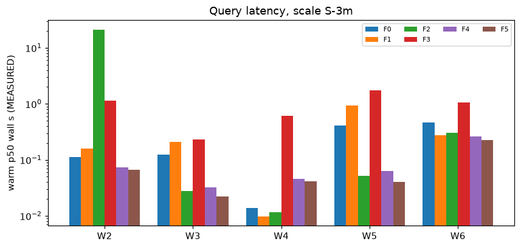

cold_mode per format (`dropcleanbuffers`: SQL buffer pool emptied; `fresh_connection`: files, OS page cache NOT dropped):

| Format | cold_mode |
|---|---|
| F0 | dropcleanbuffers |
| F1 | dropcleanbuffers |
| F2 | dropcleanbuffers |
| F3 | fresh_connection |
| F4 | fresh_connection |
| F5 | fresh_connection |
| F6-z3-rg128k | fresh_connection |
| F6-z3-rg1m | fresh_connection |
| F6-z3-rg4m | fresh_connection |
| F6-z6-rg128k | fresh_connection |
| F6-z6-rg1m | fresh_connection |
| F6-z6-rg4m | fresh_connection |
| F6-z9-rg128k | fresh_connection |
| F6-z9-rg1m | fresh_connection |
| F6-z9-rg4m | fresh_connection |

### Bytes read

| Format | Workload | Bytes read | Source class | of bytes at rest | Rows scanned |
|---|---|---|---|---|---|
| F0 | W2 | 47.00 MiB | logical_pages | 47.8 % | n/a |
| F0 | W3 | 11.33 MiB | logical_pages | 11.5 % | n/a |
| F0 | W4 | 24.00 KiB | logical_pages | 0.0 % | n/a |
| F0 | W5 | 99.46 MiB | logical_pages | 101.1 % | n/a |
| F0 | W6 | 23.78 MiB | logical_pages | 24.2 % | n/a |
| F1 | W2 | 26.84 MiB | logical_pages | 50.1 % | n/a |
| F1 | W3 | 6.18 MiB | logical_pages | 11.5 % | n/a |
| F1 | W4 | 24.00 KiB | logical_pages | 0.0 % | n/a |
| F1 | W5 | 54.19 MiB | logical_pages | 101.1 % | n/a |
| F1 | W6 | 12.98 MiB | logical_pages | 24.2 % | n/a |
| F2 | W2 | 258.11 MiB | logical_pages | 625.7 % | n/a |
| F2 | W3 | 16.09 MiB | logical_pages | 39.0 % | n/a |
| F2 | W4 | 16.12 MiB | logical_pages | 39.1 % | n/a |
| F2 | W5 | 34.48 MiB | logical_pages | 83.6 % | n/a |
| F2 | W6 | 322.62 MiB | logical_pages | 782.1 % | n/a |
| F3 | W2 | 18.17 MiB | storage_bytes | 41.6 % | 938,025 |
| F3 | W3 | 5.00 MiB | storage_bytes | 11.4 % | 258,132 |
| F3 | W4 | 7.43 MiB | storage_bytes | 17.0 % | 385,761 |
| F3 | W5 | 43.72 MiB | storage_bytes | 100.0 % | 2,246,463 |
| F3 | W6 | 10.00 MiB | storage_bytes | 22.9 % | 516,264 |
| F4 | W2 | 18.54 MiB | storage_bytes | 40.9 % | 326,891 |
| F4 | W3 | 4.45 MiB | storage_bytes | 9.8 % | 255,577 |
| F4 | W4 | 9.78 MiB | storage_bytes | 21.6 % | 134,562 |
| F4 | W5 | 19.60 MiB | storage_bytes | 43.3 % | 2,243,908 |
| F4 | W6 | 9.08 MiB | storage_bytes | 20.0 % | 513,709 |
| F5 | W2 | 11.28 MiB | storage_bytes | 41.6 % | 326,891 |
| F5 | W3 | 2.57 MiB | storage_bytes | 9.5 % | 255,577 |
| F5 | W4 | 5.60 MiB | storage_bytes | 20.7 % | 134,562 |
| F5 | W5 | 13.01 MiB | storage_bytes | 48.0 % | 2,243,908 |
| F5 | W6 | 5.29 MiB | storage_bytes | 19.5 % | 513,709 |

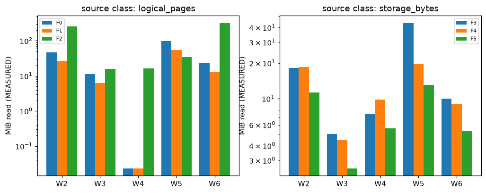

### Blob requests (Azurite, REAL counts per query)

| Format | Workload | GET | HEAD | LIST | other | Egress | EUR/1k queries, transactions (MODELLED) |
|---|---|---|---|---|---|---|---|
| F3 | W2 | 15 | 8 | 1 | 0 | 18.17 MiB | 0.013490 |
| F3 | W3 | 6 | 4 | 1 | 0 | 5.01 MiB | 0.008550 |
| F3 | W4 | 5 | 2 | 1 | 0 | 7.44 MiB | 0.007410 |
| F3 | W5 | 37 | 20 | 3 | 0 | 43.73 MiB | 0.035910 |
| F3 | W6 | 12 | 8 | 1 | 0 | 10.01 MiB | 0.012350 |
| F4 | W2 | 17 | 13 | 1 | 0 | 18.54 MiB | 0.016150 |
| F4 | W3 | 6 | 7 | 1 | 0 | 4.45 MiB | 0.009690 |
| F4 | W4 | 10 | 6 | 1 | 0 | 9.78 MiB | 0.010830 |
| F4 | W5 | 34 | 33 | 3 | 0 | 19.61 MiB | 0.039710 |
| F4 | W6 | 14 | 14 | 1 | 0 | 9.08 MiB | 0.015390 |
| F5 | W2 | 14 | 13 | 1 | 0 | 11.28 MiB | 0.015010 |
| F5 | W3 | 5 | 7 | 1 | 0 | 2.58 MiB | 0.009310 |
| F5 | W4 | 7 | 6 | 1 | 0 | 5.60 MiB | 0.009690 |
| F5 | W5 | 29 | 33 | 3 | 0 | 13.02 MiB | 0.037810 |
| F5 | W6 | 12 | 14 | 1 | 0 | 5.29 MiB | 0.014630 |

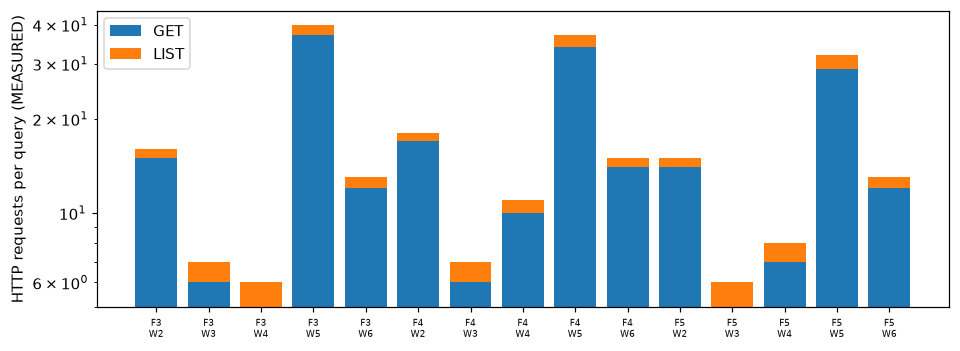

### EUR per 1,000 queries (MODELLED)

| Format | Workload | Transactions, REAL counts | Compute (SQL: 1 vCore x wall) | Transactions, 4 MiB-GET lower bound |
|---|---|---|---|---|
| F0 | W2 | n/a (no per-operation meter) | 0.0159 | n/a |
| F0 | W3 | n/a (no per-operation meter) | 0.0175 | n/a |
| F0 | W4 | n/a (no per-operation meter) | 0.0019 | n/a |
| F0 | W5 | n/a (no per-operation meter) | 0.0581 | n/a |
| F0 | W6 | n/a (no per-operation meter) | 0.0650 | n/a |
| F1 | W2 | n/a (no per-operation meter) | 0.0221 | n/a |
| F1 | W3 | n/a (no per-operation meter) | 0.0291 | n/a |
| F1 | W4 | n/a (no per-operation meter) | 0.0014 | n/a |
| F1 | W5 | n/a (no per-operation meter) | 0.1313 | n/a |
| F1 | W6 | n/a (no per-operation meter) | 0.0384 | n/a |
| F2 | W2 | n/a (no per-operation meter) | 2.9877 | n/a |
| F2 | W3 | n/a (no per-operation meter) | 0.0039 | n/a |
| F2 | W4 | n/a (no per-operation meter) | 0.0016 | n/a |
| F2 | W5 | n/a (no per-operation meter) | 0.0073 | n/a |
| F2 | W6 | n/a (no per-operation meter) | 0.0428 | n/a |
| F3 | W2 | 0.013490 | excluded (C5) | 0.001900 |
| F3 | W3 | 0.008550 | excluded (C5) | 0.000760 |
| F3 | W4 | 0.007410 | excluded (C5) | 0.000760 |
| F3 | W5 | 0.035910 | excluded (C5) | 0.004180 |
| F3 | W6 | 0.012350 | excluded (C5) | 0.001140 |
| F4 | W2 | 0.016150 | excluded (C5) | 0.001900 |
| F4 | W3 | 0.009690 | excluded (C5) | 0.000760 |
| F4 | W4 | 0.010830 | excluded (C5) | 0.001140 |
| F4 | W5 | 0.039710 | excluded (C5) | 0.001900 |
| F4 | W6 | 0.015390 | excluded (C5) | 0.001140 |
| F5 | W2 | 0.015010 | excluded (C5) | 0.001140 |
| F5 | W3 | 0.009310 | excluded (C5) | 0.000380 |
| F5 | W4 | 0.009690 | excluded (C5) | 0.000760 |
| F5 | W5 | 0.037810 | excluded (C5) | 0.001520 |
| F5 | W6 | 0.014630 | excluded (C5) | 0.000760 |

### Row groups

| Format | Files | Row groups | Mean/file | Max/file |
|---|---|---|---|---|
| F4 | 10 | 10 | 1.00 | 1 |
| F5 | 10 | 10 | 1.00 | 1 |
| F6-z3-rg128k | 10 | 24 | 2.40 | 4 |
| F6-z3-rg1m | 10 | 10 | 1.00 | 1 |
| F6-z3-rg4m | 10 | 10 | 1.00 | 1 |
| F6-z6-rg128k | 10 | 24 | 2.40 | 4 |
| F6-z6-rg1m | 10 | 10 | 1.00 | 1 |
| F6-z6-rg4m | 10 | 10 | 1.00 | 1 |
| F6-z9-rg128k | 10 | 24 | 2.40 | 4 |
| F6-z9-rg1m | 10 | 10 | 1.00 | 1 |
| F6-z9-rg4m | 10 | 10 | 1.00 | 1 |

### F6 sweep (zstd level x row-group size)

| Variant | Bytes at rest | W1 rows/s | W2 warm p50 | W3 warm p50 |
|---|---|---|---|---|
| F6-z3-rg128k | 27.05 MiB | 3,036,505 | 0.032 | 0.014 |
| F6-z3-rg1m | 27.04 MiB | 2,064,364 | 0.064 | 0.023 |
| F6-z3-rg4m | 27.04 MiB | 2,268,431 | 0.093 | 0.022 |
| F6-z6-rg128k | 27.11 MiB | 1,275,663 | 0.044 | 0.027 |
| F6-z6-rg1m | 27.10 MiB | 1,376,157 | 0.038 | 0.021 |
| F6-z6-rg4m | 27.10 MiB | 1,733,790 | 0.080 | 0.019 |
| F6-z9-rg128k | 27.03 MiB | 1,033,767 | 0.077 | 0.027 |
| F6-z9-rg1m | 27.01 MiB | 1,004,598 | 0.073 | 0.026 |
| F6-z9-rg4m | 27.01 MiB | 850,788 | 0.044 | 0.022 |

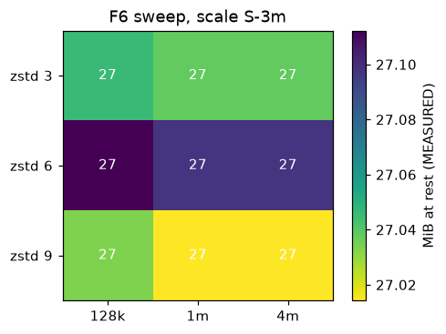

## Results, scale S

### Storage at rest

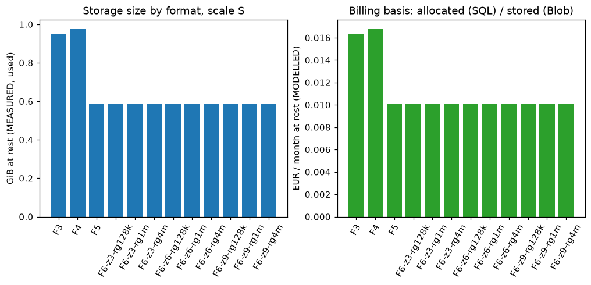

| Format | Bytes at rest (used) | B/tick | vs F5 (size) | Billed basis | EUR/month (MODELLED) | vs F5 (EUR) |
|---|---|---|---|---|---|---|
| F3 | 972.89 MiB | 20.37 | 1.6x | 972.89 MiB | 0.0163 | 1.6x |
| F4 | 998.95 MiB | 20.91 | 1.7x | 998.95 MiB | 0.0168 | 1.7x |
| F5 | 603.08 MiB | 12.63 | 1.0x | 603.08 MiB | 0.0101 | 1.0x |
| F6-z3-rg128k | 602.46 MiB | 12.61 | 1.0x | 602.46 MiB | 0.0101 | 1.0x |
| F6-z3-rg1m | 602.02 MiB | 12.60 | 1.0x | 602.02 MiB | 0.0101 | 1.0x |
| F6-z3-rg4m | 602.02 MiB | 12.60 | 1.0x | 602.02 MiB | 0.0101 | 1.0x |
| F6-z6-rg128k | 603.48 MiB | 12.63 | 1.0x | 603.48 MiB | 0.0101 | 1.0x |
| F6-z6-rg1m | 603.08 MiB | 12.63 | 1.0x | 603.08 MiB | 0.0101 | 1.0x |
| F6-z6-rg4m | 603.08 MiB | 12.63 | 1.0x | 603.08 MiB | 0.0101 | 1.0x |
| F6-z9-rg128k | 602.18 MiB | 12.61 | 1.0x | 602.18 MiB | 0.0101 | 1.0x |
| F6-z9-rg1m | 601.73 MiB | 12.60 | 1.0x | 601.73 MiB | 0.0101 | 1.0x |
| F6-z9-rg4m | 601.73 MiB | 12.60 | 1.0x | 601.73 MiB | 0.0101 | 1.0x |

### W1 bulk write (one instrument)

| Format | Runs | p50 s | p95 s | rows/s | CPU s (client) | Size of the 1-instrument store |
|---|---|---|---|---|---|---|
| F3 | 5 | 98.747 | 139.709 | 196,967 | 72.9 | 376.71 MiB |
| F4 | 5 | 29.167 | 46.374 | 666,853 | 15.5 | 382.61 MiB |
| F5 | 5 | 19.936 | 27.868 | 975,626 | 9.8 | 233.40 MiB |
| F6-z3-rg128k | 5 | 17.243 | 27.580 | 1,127,988 | 6.4 | 233.03 MiB |
| F6-z3-rg1m | 5 | 12.647 | 13.343 | 1,537,859 | 5.8 | 232.86 MiB |
| F6-z3-rg4m | 5 | 13.396 | 13.665 | 1,451,917 | 6.2 | 232.86 MiB |
| F6-z6-rg128k | 5 | 19.733 | 22.363 | 985,667 | 10.0 | 233.54 MiB |
| F6-z6-rg1m | 5 | 20.591 | 26.039 | 944,570 | 9.7 | 233.40 MiB |
| F6-z6-rg4m | 5 | 22.681 | 32.013 | 857,543 | 9.8 | 233.40 MiB |
| F6-z9-rg128k | 5 | 21.442 | 22.843 | 907,092 | 11.7 | 232.90 MiB |
| F6-z9-rg1m | 5 | 22.345 | 24.748 | 870,423 | 11.4 | 232.75 MiB |
| F6-z9-rg4m | 5 | 16.042 | 18.572 | 1,212,424 | 10.2 | 232.75 MiB |

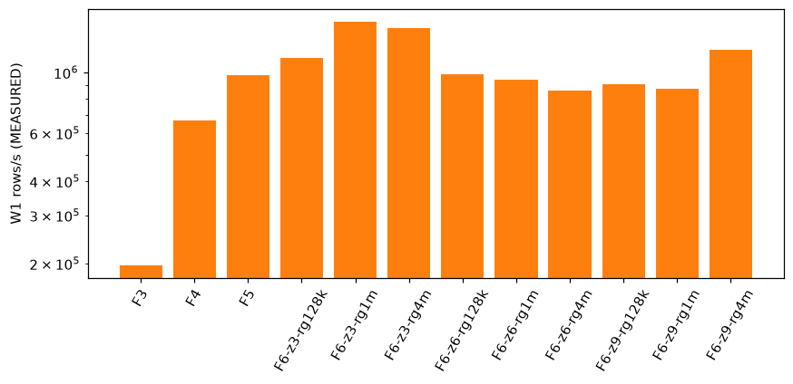

### Query latency, p50 seconds

Warm:

| Format | W2 | W3 | W4 | W5 | W6 |
|---|---|---|---|---|---|
| F3 | 18.724 | 0.349 | 0.913 | 7.414 | 1.117 |
| F4 | 3.988 | 0.277 | 0.226 | 0.742 | 0.619 |
| F5 | 1.393 | 0.150 | 0.195 | 0.570 | 0.898 |

Cold (fresh connection; see the cold_mode table):

| Format | W2 | W3 | W4 | W5 | W6 |
|---|---|---|---|---|---|
| F3 | 18.941 | 0.420 | 0.942 | 10.556 | 1.546 |
| F4 | 5.512 | 0.137 | 0.217 | 0.753 | 0.514 |
| F5 | 1.833 | 0.113 | 0.146 | 0.654 | 0.431 |

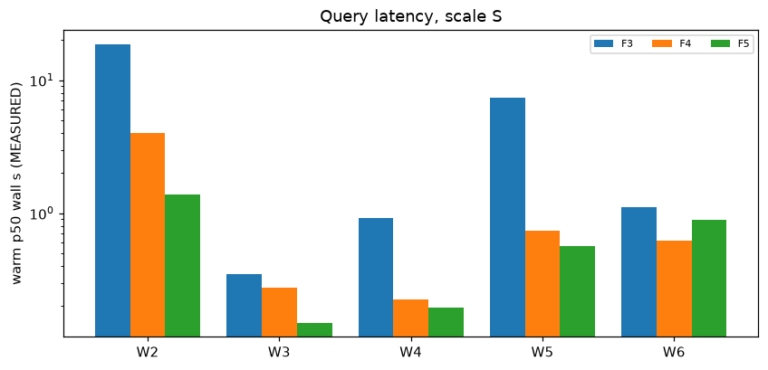

cold_mode per format (`dropcleanbuffers`: SQL buffer pool emptied; `fresh_connection`: files, OS page cache NOT dropped):

| Format | cold_mode |
|---|---|
| F3 | fresh_connection |
| F4 | fresh_connection |
| F5 | fresh_connection |
| F6-z3-rg128k | fresh_connection |
| F6-z3-rg1m | fresh_connection |
| F6-z3-rg4m | fresh_connection |
| F6-z6-rg128k | fresh_connection |
| F6-z6-rg1m | fresh_connection |
| F6-z6-rg4m | fresh_connection |
| F6-z9-rg128k | fresh_connection |
| F6-z9-rg1m | fresh_connection |
| F6-z9-rg4m | fresh_connection |

### Bytes read

| Format | Workload | Bytes read | Source class | of bytes at rest | Rows scanned |
|---|---|---|---|---|---|
| F3 | W2 | 376.71 MiB | storage_bytes | 38.7 % | 19,449,963 |
| F3 | W3 | 5.24 MiB | storage_bytes | 0.5 % | 269,750 |
| F3 | W4 | 7.43 MiB | storage_bytes | 0.8 % | 385,761 |
| F3 | W5 | 187.77 MiB | storage_bytes | 19.3 % | 9,649,280 |
| F3 | W6 | 10.49 MiB | storage_bytes | 1.1 % | 539,500 |
| F4 | W2 | 383.40 MiB | storage_bytes | 38.4 % | 6,803,460 |
| F4 | W3 | 4.62 MiB | storage_bytes | 0.5 % | 267,080 |
| F4 | W4 | 9.78 MiB | storage_bytes | 1.0 % | 134,562 |
| F4 | W5 | 83.48 MiB | storage_bytes | 8.4 % | 9,649,280 |
| F4 | W6 | 9.44 MiB | storage_bytes | 0.9 % | 536,830 |
| F5 | W2 | 234.19 MiB | storage_bytes | 38.8 % | 6,803,460 |
| F5 | W3 | 2.69 MiB | storage_bytes | 0.4 % | 267,080 |
| F5 | W4 | 5.60 MiB | storage_bytes | 0.9 % | 134,562 |
| F5 | W5 | 55.88 MiB | storage_bytes | 9.3 % | 9,649,280 |
| F5 | W6 | 5.53 MiB | storage_bytes | 0.9 % | 536,830 |

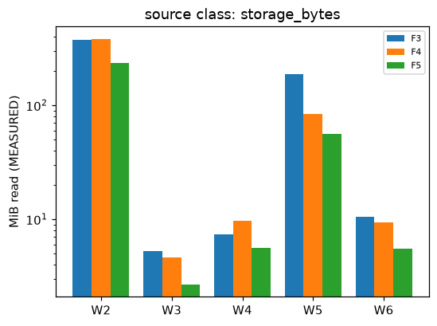

### EUR per 1,000 queries (MODELLED)

| Format | Workload | Transactions, REAL counts | Compute (SQL: 1 vCore x wall) | Transactions, 4 MiB-GET lower bound |
|---|---|---|---|---|
| F3 | W2 | n/a | excluded (C5) | 0.036100 |
| F3 | W3 | n/a | excluded (C5) | 0.000760 |
| F3 | W4 | n/a | excluded (C5) | 0.000760 |
| F3 | W5 | n/a | excluded (C5) | 0.017860 |
| F3 | W6 | n/a | excluded (C5) | 0.001140 |
| F4 | W2 | n/a | excluded (C5) | 0.036480 |
| F4 | W3 | n/a | excluded (C5) | 0.000760 |
| F4 | W4 | n/a | excluded (C5) | 0.001140 |
| F4 | W5 | n/a | excluded (C5) | 0.007980 |
| F4 | W6 | n/a | excluded (C5) | 0.001140 |
| F5 | W2 | n/a | excluded (C5) | 0.022420 |
| F5 | W3 | n/a | excluded (C5) | 0.000380 |
| F5 | W4 | n/a | excluded (C5) | 0.000760 |
| F5 | W5 | n/a | excluded (C5) | 0.005320 |
| F5 | W6 | n/a | excluded (C5) | 0.000760 |

### Row groups

| Format | Files | Row groups | Mean/file | Max/file |
|---|---|---|---|---|
| F4 | 181 | 181 | 1.00 | 1 |
| F5 | 181 | 181 | 1.00 | 1 |
| F6-z3-rg128k | 181 | 500 | 2.76 | 5 |
| F6-z3-rg1m | 181 | 181 | 1.00 | 1 |
| F6-z3-rg4m | 181 | 181 | 1.00 | 1 |
| F6-z6-rg128k | 181 | 500 | 2.76 | 5 |
| F6-z6-rg1m | 181 | 181 | 1.00 | 1 |
| F6-z6-rg4m | 181 | 181 | 1.00 | 1 |
| F6-z9-rg128k | 181 | 500 | 2.76 | 5 |
| F6-z9-rg1m | 181 | 181 | 1.00 | 1 |
| F6-z9-rg4m | 181 | 181 | 1.00 | 1 |

### F6 sweep (zstd level x row-group size)

| Variant | Bytes at rest | W1 rows/s | W2 warm p50 | W3 warm p50 |
|---|---|---|---|---|
| F6-z3-rg128k | 602.46 MiB | 1,127,988 | 3.158 | 0.155 |
| F6-z3-rg1m | 602.02 MiB | 1,537,859 | 2.524 | 0.152 |
| F6-z3-rg4m | 602.02 MiB | 1,451,917 | 2.386 | 0.140 |
| F6-z6-rg128k | 603.48 MiB | 985,667 | 1.691 | 0.173 |
| F6-z6-rg1m | 603.08 MiB | 944,570 | 2.718 | 0.182 |
| F6-z6-rg4m | 603.08 MiB | 857,543 | 2.204 | 0.100 |
| F6-z9-rg128k | 602.18 MiB | 907,092 | 2.543 | 0.144 |
| F6-z9-rg1m | 601.73 MiB | 870,423 | 3.242 | 0.253 |
| F6-z9-rg4m | 601.73 MiB | 1,212,424 | 1.543 | 0.144 |

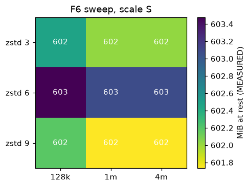

## Why F5 wins

Share of the stored bytes a query actually reads (warm, scale S-3m):

| Format | W3 (one month) | W4 (last price) | W2 (full scan) |
|---|---|---|---|
| F3 | 11.44 % | 17.00 % | 41.55 % |
| F4 | 9.81 % | 21.58 % | 40.92 % |
| F5 | 9.50 % | 20.66 % | 41.63 % |
| F0 | 11.52 % | 0.02 % | 47.79 % |
| F1 | 11.53 % | 0.04 % | 50.09 % |
| F2 | 39.02 % | 39.09 % | 625.72 % |

Encoding ablation, one instrument-month (`instrument=SYN.HH.TICK/year=2023/month=07/part-00000.parquet`); MEASURED compressed column bytes per tick:

| Variant (zstd, same data) | ts_ns B/tick | price B/tick | file B/tick |
|---|---|---|---|
| F5 as written | 4.449 | 6.023 | 12.880 |
| ts_ns without DELTA_BINARY_PACKED (PLAIN) | 7.016 | 6.023 | 15.446 |
| floats without BYTE_STREAM_SPLIT (PLAIN) | 4.449 | 7.143 | 13.629 |
| neither | 7.016 | 7.143 | 16.196 |

* Delta encoding: tick timestamps are sorted and close together, so DELTA_BINARY_PACKED stores small deltas; the ablation table gives the measured ts_ns bytes per tick.
* Byte-stream-split: it regroups the float bytes so zstd sees the near-constant exponent bytes together; see the price column.
* Skipping: W3/W4 read a small share of the bytes, but in these runs that is month-partition pruning, which F3, F4 and F5 share. Every F4/F5 object holds one row group (row-group table), so row-group min/max statistics could not skip anything at this object size; the probe below measures what they do with 128k-row groups.

Row-group statistics probe: one instrument-month, a window of about 2 % of its ticks (MEASURED from the footer statistics; groups whose ts_ns range misses the window are skipped):

| Row-group rows | Row groups | Rows returned | Rows scanned | Bytes read | of file |
|---|---|---|---|---|---|
| 1,000,000 | 1 | 1 | 236,417 | 2.85 MiB | 99.9 % |
| 128,000 | 2 | 1 | 128,000 | 1.54 MiB | 54.1 % |

## Reproducibility

Same scale and seed, second run: 22 format x workload x cache cells compared.

* Sizes: worst relative difference 0.0000 % (tolerance 1 %): PASS.
* Timings, all cells: 4 of 22 within 15 %.
* Timings, cells with p50 >= 100 ms: 4 of 22 within 15 % (worst 76.4 %): FAIL. SPEC-02 section 6 asks for timings within this tolerance; on a shared laptop with other containers running they are not, so timing ratios in this report are indicative only.

Worst timing deltas:

| Format | Workload | Cache | Run A p50 | Run B p50 | Delta |
|---|---|---|---|---|---|
| F5 | W6 | warm | 0.898 | 0.211 | 76.4 % |
| F5 | W4 | warm | 0.195 | 0.067 | 65.4 % |
| F4 | W2 | cold | 5.512 | 2.025 | 63.3 % |
| F5 | W5 | warm | 0.570 | 0.218 | 61.7 % |
| F5 | W5 | cold | 0.654 | 0.273 | 58.2 % |
| F5 | W4 | cold | 0.146 | 0.072 | 50.9 % |
| F5 | W6 | cold | 0.431 | 0.230 | 46.7 % |
| F4 | W3 | warm | 0.277 | 0.150 | 45.8 % |

### Same-run replicates

Identical configuration measured twice in one run (10 cells, 0 within 15 %; of the 10 cells with p50 >= 100 ms, 0 within). This is the floor for how far two honest runs can differ.

| Format | Workload | Cache | First p50 | Second p50 | Delta |
|---|---|---|---|---|---|
| F6-z9-rg1m | W2 | cold | 1.304 | 0.880 | 32.5 % |
| F6-z9-rg1m | W2 | warm | 3.242 | 0.943 | 70.9 % |
| F6-z9-rg1m | W3 | cold | 0.186 | 0.081 | 56.2 % |
| F6-z9-rg1m | W3 | warm | 0.253 | 0.112 | 55.9 % |
| F6-z9-rg1m | W4 | cold | 0.188 | 0.091 | 51.5 % |
| F6-z9-rg1m | W4 | warm | 0.242 | 0.091 | 62.4 % |
| F6-z9-rg1m | W5 | cold | 0.676 | 0.541 | 19.9 % |
| F6-z9-rg1m | W5 | warm | 0.881 | 0.348 | 60.5 % |
| F6-z9-rg1m | W6 | cold | 0.489 | 0.319 | 34.8 % |
| F6-z9-rg1m | W6 | warm | 0.547 | 0.316 | 42.2 % |

## Not run

* Scale M (all formats): NOT RUN. Local run time is prohibitive on this shared machine (a 300M-tick dataset; SQL loads ran at 1.5k-15k rows/s here). Per SPEC-02 section 5, M-scale SQL is modelled from the Azure S run, and absolute numbers come with the Azure run (NEEDS-CLOUD). No M number is quoted.
* SQL formats F0-F2 at full S (50.1M ticks): NOT RUN. They ran on a 3-month slice of S (label S-3m, 2.24M ticks, same seed and generator). File formats ran on both the slice and the full S.
* Azurite request counts at full S: NOT RUN; counted on the S-3m slice only.
* Azure Blob / Azure SQL / Container Apps absolute numbers: NEEDS-CLOUD.

## Caveats

* Local only: one Windows laptop, SQL Server in Docker, Azurite. No Azure number here; Azure runs
  are NEEDS-CLOUD and absolute latencies will differ (network, Container Apps 1 vCPU / 2 GiB).
* Cold/warm asymmetry: SQL empties its buffer pool (`DBCC DROPCLEANBUFFERS`), files only get a
  fresh DuckDB connection, so the OS page cache stays warm and file "cold" understates a truly
  cold read.
* TDS (SQL, a socket and ODBC) vs in-process DuckDB: part of the latency gap is protocol and
  process boundary, not storage format. The SQL W1 load is Python-bound (`fast_executemany`
  batches), so SQL write throughput says more about the loader than about the engine.
* SQL W2 plan shape: W2 is a grouped pass plus two index seeks per day for open/close; another
  formulation could change the F0-F2 numbers.
* SQL CPU is not in the CPU column (client process only); SQL bytes read are logical pages, not
  physical I/O.
* F6 row groups: an instrument-month holds fewer ticks than one 1M-row group at the larger rows
  per month, so the 1m and 4m settings can produce identical files; see the row-group table.
* Slice: F0-F2 ran on the 3-month slice "S-3m" (2.2M ticks), not on full S, so SQL and file timings
  are compared on the slice only; full-S rows exist for F3-F6. Size ratios are compared per tick
  across scales in the bytes-per-tick table.
* Shared machine: other containers (further SQL Server instances, an emulator spinning at over
  100 % CPU) competed for the 6 cores during all runs, and run A of full S overlapped with
  other work of mine. Timings are therefore noisy; see the reproducibility and replicate sections
  for the measured spread. Sizes and byte counts are deterministic and unaffected.
* SQL loads ran at about 1.5k-15k rows/s here, far below an uncontended host.
* Synthetic data: compression ratios depend on the generator's price process and tick spacing.

## Appendix, every cell

| Scale | Format | Workload | Cache | p50 s | p95 s | rows/s | CPU s (client) | Bytes at rest | Bytes read | EUR/month at rest | EUR/1k queries (lower bound) |
|---|---|---|---|---|---|---|---|---|---|---|---|
| S | F3 | W1 | n/a | 98.7472 | 139.7087 | 196,967 | 72.906 | 395,004,524 | n/a | 0.006327 (MODELLED) | n/a |
| S | F3 | W2 | cold | 18.9406 | 26.4591 | 1,026,893 | 23.078 | 1,020,147,473 | 395,004,524 | 0.016341 (MODELLED) | 0.036100 (MODELLED) |
| S | F3 | W2 | warm | 18.7235 | 25.0552 | 1,038,797 | 22.547 | 1,020,147,473 | 395,004,524 | 0.016341 (MODELLED) | 0.036100 (MODELLED) |
| S | F3 | W3 | cold | 0.4201 | 0.6111 | 642,165 | 0.359 | 1,020,147,473 | 5,498,697 | 0.016341 (MODELLED) | 0.000760 (MODELLED) |
| S | F3 | W3 | warm | 0.3489 | 0.5485 | 773,114 | 0.297 | 1,020,147,473 | 5,498,697 | 0.016341 (MODELLED) | 0.000760 (MODELLED) |
| S | F3 | W4 | cold | 0.9424 | 1.1332 | 409,347 | 0.516 | 1,020,147,473 | 7,793,990 | 0.016341 (MODELLED) | 0.000760 (MODELLED) |
| S | F3 | W4 | warm | 0.9129 | 0.9710 | 422,543 | 0.453 | 1,020,147,473 | 7,793,990 | 0.016341 (MODELLED) | 0.000760 (MODELLED) |
| S | F3 | W5 | cold | 10.5559 | 13.4198 | 914,112 | 8.234 | 1,020,147,473 | 196,886,039 | 0.016341 (MODELLED) | 0.017860 (MODELLED) |
| S | F3 | W5 | warm | 7.4136 | 8.7291 | 1,301,561 | 8.094 | 1,020,147,473 | 196,886,039 | 0.016341 (MODELLED) | 0.017860 (MODELLED) |
| S | F3 | W6 | cold | 1.5462 | 1.7960 | 348,919 | 1.078 | 1,020,147,473 | 10,997,394 | 0.016341 (MODELLED) | 0.001140 (MODELLED) |
| S | F3 | W6 | warm | 1.1170 | 1.3639 | 482,972 | 0.969 | 1,020,147,473 | 10,997,394 | 0.016341 (MODELLED) | 0.001140 (MODELLED) |
| S | F4 | W1 | n/a | 29.1668 | 46.3744 | 666,853 | 15.547 | 401,191,524 | n/a | 0.006427 (MODELLED) | n/a |
| S | F4 | W2 | cold | 5.5119 | 6.1979 | 1,234,322 | 2.484 | 1,047,475,310 | 402,019,644 | 0.016779 (MODELLED) | 0.036480 (MODELLED) |
| S | F4 | W2 | warm | 3.9881 | 4.6585 | 1,705,952 | 2.203 | 1,047,475,310 | 402,019,644 | 0.016779 (MODELLED) | 0.036480 (MODELLED) |
| S | F4 | W3 | cold | 0.1373 | 0.2473 | 1,944,793 | 0.109 | 1,047,475,310 | 4,847,428 | 0.016779 (MODELLED) | 0.000760 (MODELLED) |
| S | F4 | W3 | warm | 0.2773 | 0.3468 | 963,290 | 0.109 | 1,047,475,310 | 4,847,428 | 0.016779 (MODELLED) | 0.000760 (MODELLED) |
| S | F4 | W4 | cold | 0.2175 | 0.3266 | 618,699 | 0.094 | 1,047,475,310 | 10,252,365 | 0.016779 (MODELLED) | 0.001140 (MODELLED) |
| S | F4 | W4 | warm | 0.2260 | 0.3414 | 595,520 | 0.094 | 1,047,475,310 | 10,252,365 | 0.016779 (MODELLED) | 0.001140 (MODELLED) |
| S | F4 | W5 | cold | 0.7525 | 1.0902 | 12,822,350 | 0.594 | 1,047,475,310 | 87,540,285 | 0.016779 (MODELLED) | 0.007980 (MODELLED) |
| S | F4 | W5 | warm | 0.7419 | 0.8876 | 13,006,782 | 0.641 | 1,047,475,310 | 87,540,285 | 0.016779 (MODELLED) | 0.007980 (MODELLED) |
| S | F4 | W6 | cold | 0.5144 | 0.7244 | 1,043,619 | 0.406 | 1,047,475,310 | 9,895,644 | 0.016779 (MODELLED) | 0.001140 (MODELLED) |
| S | F4 | W6 | warm | 0.6187 | 0.6713 | 867,681 | 0.312 | 1,047,475,310 | 9,895,644 | 0.016779 (MODELLED) | 0.001140 (MODELLED) |
| S | F5 | W1 | n/a | 19.9359 | 27.8677 | 975,626 | 9.844 | 244,734,984 | n/a | 0.003920 (MODELLED) | n/a |
| S | F5 | W2 | cold | 1.8334 | 2.6822 | 3,710,861 | 1.703 | 632,371,312 | 245,564,399 | 0.010130 (MODELLED) | 0.022420 (MODELLED) |
| S | F5 | W2 | warm | 1.3933 | 4.5440 | 4,883,089 | 1.719 | 632,371,312 | 245,564,399 | 0.010130 (MODELLED) | 0.022420 (MODELLED) |
| S | F5 | W3 | cold | 0.1130 | 0.2406 | 2,362,977 | 0.062 | 632,371,312 | 2,822,824 | 0.010130 (MODELLED) | 0.000380 (MODELLED) |
| S | F5 | W3 | warm | 0.1504 | 0.1875 | 1,775,873 | 0.078 | 632,371,312 | 2,822,824 | 0.010130 (MODELLED) | 0.000380 (MODELLED) |
| S | F5 | W4 | cold | 0.1461 | 0.2888 | 920,871 | 0.109 | 632,371,312 | 5,871,384 | 0.010130 (MODELLED) | 0.000760 (MODELLED) |
| S | F5 | W4 | warm | 0.1945 | 0.3226 | 691,808 | 0.094 | 632,371,312 | 5,871,384 | 0.010130 (MODELLED) | 0.000760 (MODELLED) |
| S | F5 | W5 | cold | 0.6545 | 0.7221 | 14,743,793 | 0.484 | 632,371,312 | 58,593,011 | 0.010130 (MODELLED) | 0.005320 (MODELLED) |
| S | F5 | W5 | warm | 0.5701 | 0.6267 | 16,925,821 | 0.438 | 632,371,312 | 58,593,011 | 0.010130 (MODELLED) | 0.005320 (MODELLED) |
| S | F5 | W6 | cold | 0.4315 | 0.5392 | 1,244,215 | 0.312 | 632,371,312 | 5,800,066 | 0.010130 (MODELLED) | 0.000760 (MODELLED) |
| S | F5 | W6 | warm | 0.8978 | 2.1359 | 597,951 | 0.359 | 632,371,312 | 5,800,066 | 0.010130 (MODELLED) | 0.000760 (MODELLED) |
| S | F6-z3-rg128k | W1 | n/a | 17.2431 | 27.5804 | 1,127,988 | 6.359 | 244,349,921 | n/a | 0.003914 (MODELLED) | n/a |
| S | F6-z3-rg128k | W2 | cold | 2.4102 | 3.4787 | 2,822,754 | 1.797 | 631,730,213 | 245,079,949 | 0.010120 (MODELLED) | 0.022420 (MODELLED) |
| S | F6-z3-rg128k | W2 | warm | 3.1578 | 4.3869 | 2,154,476 | 1.938 | 631,730,213 | 245,079,949 | 0.010120 (MODELLED) | 0.022420 (MODELLED) |
| S | F6-z3-rg128k | W3 | cold | 0.1344 | 0.1780 | 1,987,791 | 0.094 | 631,730,213 | 2,819,206 | 0.010120 (MODELLED) | 0.000380 (MODELLED) |
| S | F6-z3-rg128k | W3 | warm | 0.1547 | 0.3425 | 1,726,962 | 0.094 | 631,730,213 | 2,819,206 | 0.010120 (MODELLED) | 0.000380 (MODELLED) |
| S | F6-z3-rg128k | W4 | cold | 0.1756 | 0.2562 | 766,346 | 0.078 | 631,730,213 | 1,837,155 | 0.010120 (MODELLED) | 0.000380 (MODELLED) |
| S | F6-z3-rg128k | W4 | warm | 0.1612 | 0.2613 | 834,796 | 0.094 | 631,730,213 | 1,837,155 | 0.010120 (MODELLED) | 0.000380 (MODELLED) |
| S | F6-z3-rg128k | W5 | cold | 0.6560 | 0.7813 | 14,708,737 | 0.422 | 631,730,213 | 58,882,069 | 0.010120 (MODELLED) | 0.005700 (MODELLED) |
| S | F6-z3-rg128k | W5 | warm | 0.5565 | 0.7393 | 17,338,888 | 0.391 | 631,730,213 | 58,882,069 | 0.010120 (MODELLED) | 0.005700 (MODELLED) |
| S | F6-z3-rg128k | W6 | cold | 0.3953 | 0.6034 | 1,357,870 | 0.359 | 631,730,213 | 5,793,717 | 0.010120 (MODELLED) | 0.000760 (MODELLED) |
| S | F6-z3-rg128k | W6 | warm | 0.4008 | 0.5948 | 1,339,522 | 0.344 | 631,730,213 | 5,793,717 | 0.010120 (MODELLED) | 0.000760 (MODELLED) |
| S | F6-z3-rg1m | W1 | n/a | 12.6474 | 13.3426 | 1,537,859 | 5.781 | 244,174,927 | n/a | 0.003911 (MODELLED) | n/a |
| S | F6-z3-rg1m | W2 | cold | 1.8685 | 5.1847 | 3,641,101 | 1.781 | 631,262,323 | 245,004,222 | 0.010112 (MODELLED) | 0.022420 (MODELLED) |
| S | F6-z3-rg1m | W2 | warm | 2.5242 | 5.1470 | 2,695,329 | 1.828 | 631,262,323 | 245,004,222 | 0.010112 (MODELLED) | 0.022420 (MODELLED) |
| S | F6-z3-rg1m | W3 | cold | 0.1651 | 0.2389 | 1,618,006 | 0.094 | 631,262,323 | 2,810,653 | 0.010112 (MODELLED) | 0.000380 (MODELLED) |
| S | F6-z3-rg1m | W3 | warm | 0.1517 | 0.2146 | 1,760,002 | 0.094 | 631,262,323 | 2,810,653 | 0.010112 (MODELLED) | 0.000380 (MODELLED) |
| S | F6-z3-rg1m | W4 | cold | 0.3805 | 0.4645 | 353,687 | 0.094 | 631,262,323 | 5,855,077 | 0.010112 (MODELLED) | 0.000760 (MODELLED) |
| S | F6-z3-rg1m | W4 | warm | 0.2467 | 0.2697 | 545,447 | 0.109 | 631,262,323 | 5,855,077 | 0.010112 (MODELLED) | 0.000760 (MODELLED) |
| S | F6-z3-rg1m | W5 | cold | 0.5624 | 0.6868 | 17,156,444 | 0.484 | 631,262,323 | 58,537,068 | 0.010112 (MODELLED) | 0.005320 (MODELLED) |
| S | F6-z3-rg1m | W5 | warm | 0.6819 | 0.7101 | 14,150,581 | 0.469 | 631,262,323 | 58,537,068 | 0.010112 (MODELLED) | 0.005320 (MODELLED) |
| S | F6-z3-rg1m | W6 | cold | 0.5172 | 0.6438 | 1,038,023 | 0.406 | 631,262,323 | 5,775,845 | 0.010112 (MODELLED) | 0.000760 (MODELLED) |
| S | F6-z3-rg1m | W6 | warm | 0.4898 | 0.7434 | 1,095,913 | 0.344 | 631,262,323 | 5,775,845 | 0.010112 (MODELLED) | 0.000760 (MODELLED) |
| S | F6-z3-rg4m | W1 | n/a | 13.3961 | 13.6646 | 1,451,917 | 6.156 | 244,174,927 | n/a | 0.003911 (MODELLED) | n/a |
| S | F6-z3-rg4m | W2 | cold | 1.2757 | 5.1649 | 5,333,112 | 1.812 | 631,262,323 | 245,004,222 | 0.010112 (MODELLED) | 0.022420 (MODELLED) |
| S | F6-z3-rg4m | W2 | warm | 2.3862 | 3.6466 | 2,851,112 | 1.812 | 631,262,323 | 245,004,222 | 0.010112 (MODELLED) | 0.022420 (MODELLED) |
| S | F6-z3-rg4m | W3 | cold | 0.2218 | 0.2743 | 1,204,133 | 0.078 | 631,262,323 | 2,810,653 | 0.010112 (MODELLED) | 0.000380 (MODELLED) |
| S | F6-z3-rg4m | W3 | warm | 0.1404 | 0.2462 | 1,902,201 | 0.078 | 631,262,323 | 2,810,653 | 0.010112 (MODELLED) | 0.000380 (MODELLED) |
| S | F6-z3-rg4m | W4 | cold | 0.2193 | 0.2519 | 613,566 | 0.094 | 631,262,323 | 5,855,077 | 0.010112 (MODELLED) | 0.000760 (MODELLED) |
| S | F6-z3-rg4m | W4 | warm | 0.2009 | 0.2458 | 669,923 | 0.094 | 631,262,323 | 5,855,077 | 0.010112 (MODELLED) | 0.000760 (MODELLED) |
| S | F6-z3-rg4m | W5 | cold | 0.5710 | 0.6348 | 16,897,574 | 0.391 | 631,262,323 | 58,537,068 | 0.010112 (MODELLED) | 0.005320 (MODELLED) |
| S | F6-z3-rg4m | W5 | warm | 0.5358 | 0.5943 | 18,009,911 | 0.422 | 631,262,323 | 58,537,068 | 0.010112 (MODELLED) | 0.005320 (MODELLED) |
| S | F6-z3-rg4m | W6 | cold | 0.5216 | 0.7541 | 1,029,166 | 0.344 | 631,262,323 | 5,775,845 | 0.010112 (MODELLED) | 0.000760 (MODELLED) |
| S | F6-z3-rg4m | W6 | warm | 0.5194 | 0.5479 | 1,033,505 | 0.359 | 631,262,323 | 5,775,845 | 0.010112 (MODELLED) | 0.000760 (MODELLED) |
| S | F6-z6-rg128k | W1 | n/a | 19.7328 | 22.3627 | 985,667 | 10.016 | 244,884,201 | n/a | 0.003923 (MODELLED) | n/a |
| S | F6-z6-rg128k | W2 | cold | 1.2782 | 5.4290 | 5,322,512 | 1.906 | 632,794,851 | 245,614,350 | 0.010137 (MODELLED) | 0.022420 (MODELLED) |
| S | F6-z6-rg128k | W2 | warm | 1.6914 | 5.8965 | 4,022,280 | 1.734 | 632,794,851 | 245,614,350 | 0.010137 (MODELLED) | 0.022420 (MODELLED) |
| S | F6-z6-rg128k | W3 | cold | 0.1985 | 0.2468 | 1,345,400 | 0.094 | 632,794,851 | 2,819,235 | 0.010137 (MODELLED) | 0.000380 (MODELLED) |
| S | F6-z6-rg128k | W3 | warm | 0.1726 | 0.2316 | 1,547,695 | 0.078 | 632,794,851 | 2,819,235 | 0.010137 (MODELLED) | 0.000380 (MODELLED) |
| S | F6-z6-rg128k | W4 | cold | 0.1773 | 0.3925 | 758,785 | 0.078 | 632,794,851 | 1,837,079 | 0.010137 (MODELLED) | 0.000380 (MODELLED) |
| S | F6-z6-rg128k | W4 | warm | 0.2625 | 0.3110 | 512,621 | 0.094 | 632,794,851 | 1,837,079 | 0.010137 (MODELLED) | 0.000380 (MODELLED) |
| S | F6-z6-rg128k | W5 | cold | 0.5797 | 0.8765 | 16,645,087 | 0.500 | 632,794,851 | 58,907,361 | 0.010137 (MODELLED) | 0.005700 (MODELLED) |
| S | F6-z6-rg128k | W5 | warm | 0.5296 | 0.7252 | 18,219,554 | 0.391 | 632,794,851 | 58,907,361 | 0.010137 (MODELLED) | 0.005700 (MODELLED) |
| S | F6-z6-rg128k | W6 | cold | 0.4110 | 0.4635 | 1,306,250 | 0.328 | 632,794,851 | 5,793,654 | 0.010137 (MODELLED) | 0.000760 (MODELLED) |
| S | F6-z6-rg128k | W6 | warm | 0.5384 | 0.6528 | 997,116 | 0.359 | 632,794,851 | 5,793,654 | 0.010137 (MODELLED) | 0.000760 (MODELLED) |
| S | F6-z6-rg1m | W1 | n/a | 20.5913 | 26.0393 | 944,570 | 9.656 | 244,734,984 | n/a | 0.003920 (MODELLED) | n/a |
| S | F6-z6-rg1m | W2 | cold | 1.3027 | 3.2339 | 5,222,661 | 1.734 | 632,371,312 | 245,564,399 | 0.010130 (MODELLED) | 0.022420 (MODELLED) |
| S | F6-z6-rg1m | W2 | warm | 2.7176 | 3.1706 | 2,503,479 | 1.750 | 632,371,312 | 245,564,399 | 0.010130 (MODELLED) | 0.022420 (MODELLED) |
| S | F6-z6-rg1m | W3 | cold | 0.1451 | 0.2147 | 1,841,234 | 0.109 | 632,371,312 | 2,822,824 | 0.010130 (MODELLED) | 0.000380 (MODELLED) |
| S | F6-z6-rg1m | W3 | warm | 0.1819 | 0.2998 | 1,468,318 | 0.078 | 632,371,312 | 2,822,824 | 0.010130 (MODELLED) | 0.000380 (MODELLED) |
| S | F6-z6-rg1m | W4 | cold | 0.2050 | 0.3553 | 656,336 | 0.094 | 632,371,312 | 5,871,384 | 0.010130 (MODELLED) | 0.000760 (MODELLED) |
| S | F6-z6-rg1m | W4 | warm | 0.1548 | 0.2728 | 869,063 | 0.078 | 632,371,312 | 5,871,384 | 0.010130 (MODELLED) | 0.000760 (MODELLED) |
| S | F6-z6-rg1m | W5 | cold | 0.6126 | 0.7248 | 15,751,378 | 0.406 | 632,371,312 | 58,593,011 | 0.010130 (MODELLED) | 0.005320 (MODELLED) |
| S | F6-z6-rg1m | W5 | warm | 0.5920 | 0.7640 | 16,298,975 | 0.438 | 632,371,312 | 58,593,011 | 0.010130 (MODELLED) | 0.005320 (MODELLED) |
| S | F6-z6-rg1m | W6 | cold | 0.4580 | 0.6224 | 1,172,183 | 0.359 | 632,371,312 | 5,800,066 | 0.010130 (MODELLED) | 0.000760 (MODELLED) |
| S | F6-z6-rg1m | W6 | warm | 0.5332 | 0.6335 | 1,006,789 | 0.406 | 632,371,312 | 5,800,066 | 0.010130 (MODELLED) | 0.000760 (MODELLED) |
| S | F6-z6-rg4m | W1 | n/a | 22.6810 | 32.0126 | 857,543 | 9.750 | 244,734,984 | n/a | 0.003920 (MODELLED) | n/a |
| S | F6-z6-rg4m | W2 | cold | 1.1870 | 2.6661 | 5,731,600 | 1.781 | 632,371,312 | 245,564,399 | 0.010130 (MODELLED) | 0.022420 (MODELLED) |
| S | F6-z6-rg4m | W2 | warm | 2.2036 | 3.8501 | 3,087,483 | 1.812 | 632,371,312 | 245,564,399 | 0.010130 (MODELLED) | 0.022420 (MODELLED) |
| S | F6-z6-rg4m | W3 | cold | 0.1350 | 0.3349 | 1,978,926 | 0.078 | 632,371,312 | 2,822,824 | 0.010130 (MODELLED) | 0.000380 (MODELLED) |
| S | F6-z6-rg4m | W3 | warm | 0.1001 | 0.1551 | 2,669,137 | 0.078 | 632,371,312 | 2,822,824 | 0.010130 (MODELLED) | 0.000380 (MODELLED) |
| S | F6-z6-rg4m | W4 | cold | 0.1703 | 0.2372 | 790,199 | 0.141 | 632,371,312 | 5,871,384 | 0.010130 (MODELLED) | 0.000760 (MODELLED) |
| S | F6-z6-rg4m | W4 | warm | 0.1378 | 0.1621 | 976,197 | 0.094 | 632,371,312 | 5,871,384 | 0.010130 (MODELLED) | 0.000760 (MODELLED) |
| S | F6-z6-rg4m | W5 | cold | 0.5952 | 0.6496 | 16,212,588 | 0.469 | 632,371,312 | 58,593,011 | 0.010130 (MODELLED) | 0.005320 (MODELLED) |
| S | F6-z6-rg4m | W5 | warm | 0.6498 | 0.8975 | 14,850,054 | 0.422 | 632,371,312 | 58,593,011 | 0.010130 (MODELLED) | 0.005320 (MODELLED) |
| S | F6-z6-rg4m | W6 | cold | 0.5193 | 0.6379 | 1,033,724 | 0.391 | 632,371,312 | 5,800,066 | 0.010130 (MODELLED) | 0.000760 (MODELLED) |
| S | F6-z6-rg4m | W6 | warm | 0.4742 | 0.5109 | 1,132,100 | 0.391 | 632,371,312 | 5,800,066 | 0.010130 (MODELLED) | 0.000760 (MODELLED) |
| S | F6-z9-rg128k | W1 | n/a | 21.4421 | 22.8428 | 907,092 | 11.719 | 244,208,695 | n/a | 0.003912 (MODELLED) | n/a |
| S | F6-z9-rg128k | W2 | cold | 0.8709 | 2.7843 | 7,811,971 | 1.688 | 631,429,356 | 244,938,875 | 0.010115 (MODELLED) | 0.022420 (MODELLED) |
| S | F6-z9-rg128k | W2 | warm | 2.5433 | 3.3454 | 2,675,075 | 1.578 | 631,429,356 | 244,938,875 | 0.010115 (MODELLED) | 0.022420 (MODELLED) |
| S | F6-z9-rg128k | W3 | cold | 0.2019 | 0.5585 | 1,322,944 | 0.094 | 631,429,356 | 2,814,013 | 0.010115 (MODELLED) | 0.000380 (MODELLED) |
| S | F6-z9-rg128k | W3 | warm | 0.1442 | 0.1863 | 1,852,521 | 0.094 | 631,429,356 | 2,814,013 | 0.010115 (MODELLED) | 0.000380 (MODELLED) |
| S | F6-z9-rg128k | W4 | cold | 0.1600 | 0.3270 | 840,913 | 0.094 | 631,429,356 | 1,836,567 | 0.010115 (MODELLED) | 0.000380 (MODELLED) |
| S | F6-z9-rg128k | W4 | warm | 0.1813 | 0.2267 | 742,022 | 0.078 | 631,429,356 | 1,836,567 | 0.010115 (MODELLED) | 0.000380 (MODELLED) |
| S | F6-z9-rg128k | W5 | cold | 0.5768 | 1.3202 | 16,729,405 | 0.312 | 631,429,356 | 58,508,775 | 0.010115 (MODELLED) | 0.005320 (MODELLED) |
| S | F6-z9-rg128k | W5 | warm | 0.5227 | 0.6231 | 18,458,852 | 0.406 | 631,429,356 | 58,508,775 | 0.010115 (MODELLED) | 0.005320 (MODELLED) |
| S | F6-z9-rg128k | W6 | cold | 0.2857 | 0.4133 | 1,878,727 | 0.344 | 631,429,356 | 5,783,179 | 0.010115 (MODELLED) | 0.000760 (MODELLED) |
| S | F6-z9-rg128k | W6 | warm | 0.3586 | 0.4153 | 1,496,839 | 0.281 | 631,429,356 | 5,783,179 | 0.010115 (MODELLED) | 0.000760 (MODELLED) |
| S | F6-z9-rg1m | W1 | n/a | 22.3454 | 24.7483 | 870,423 | 11.422 | 244,055,127 | n/a | 0.003909 (MODELLED) | n/a |
| S | F6-z9-rg1m | W2 | cold | 1.3037 | 6.1255 | 5,218,457 | 1.734 | 630,963,726 | 244,884,573 | 0.010107 (MODELLED) | 0.022420 (MODELLED) |
| S | F6-z9-rg1m | W2 | warm | 3.2422 | 4.5709 | 2,098,425 | 1.812 | 630,963,726 | 244,884,573 | 0.010107 (MODELLED) | 0.022420 (MODELLED) |
| S | F6-z9-rg1m | W3 | cold | 0.1859 | 0.2646 | 1,437,054 | 0.062 | 630,963,726 | 2,820,769 | 0.010107 (MODELLED) | 0.000380 (MODELLED) |
| S | F6-z9-rg1m | W3 | warm | 0.2526 | 0.3140 | 1,057,285 | 0.094 | 630,963,726 | 2,820,769 | 0.010107 (MODELLED) | 0.000380 (MODELLED) |
| S | F6-z9-rg1m | W4 | cold | 0.1884 | 0.2446 | 714,102 | 0.094 | 630,963,726 | 5,849,632 | 0.010107 (MODELLED) | 0.000760 (MODELLED) |
| S | F6-z9-rg1m | W4 | warm | 0.2417 | 0.2681 | 556,630 | 0.062 | 630,963,726 | 5,849,632 | 0.010107 (MODELLED) | 0.000760 (MODELLED) |
| S | F6-z9-rg1m | W5 | cold | 0.6758 | 1.0196 | 14,279,085 | 0.453 | 630,963,726 | 58,481,515 | 0.010107 (MODELLED) | 0.005320 (MODELLED) |
| S | F6-z9-rg1m | W5 | warm | 0.8810 | 1.2615 | 10,952,641 | 0.344 | 630,963,726 | 58,481,515 | 0.010107 (MODELLED) | 0.005320 (MODELLED) |
| S | F6-z9-rg1m | W6 | cold | 0.4890 | 0.6895 | 1,097,709 | 0.328 | 630,963,726 | 5,795,925 | 0.010107 (MODELLED) | 0.000760 (MODELLED) |
| S | F6-z9-rg1m | W6 | warm | 0.5469 | 0.6334 | 981,533 | 0.328 | 630,963,726 | 5,795,925 | 0.010107 (MODELLED) | 0.000760 (MODELLED) |
| S | F6-z9-rg4m | W1 | n/a | 16.0422 | 18.5716 | 1,212,424 | 10.234 | 244,055,127 | n/a | 0.003909 (MODELLED) | n/a |
| S | F6-z9-rg4m | W2 | cold | 1.1097 | 2.3219 | 6,130,658 | 1.484 | 630,963,726 | 244,884,573 | 0.010107 (MODELLED) | 0.022420 (MODELLED) |
| S | F6-z9-rg4m | W2 | warm | 1.5428 | 3.0991 | 4,409,810 | 1.594 | 630,963,726 | 244,884,573 | 0.010107 (MODELLED) | 0.022420 (MODELLED) |
| S | F6-z9-rg4m | W3 | cold | 0.0855 | 0.0928 | 3,121,997 | 0.047 | 630,963,726 | 2,820,769 | 0.010107 (MODELLED) | 0.000380 (MODELLED) |
| S | F6-z9-rg4m | W3 | warm | 0.1441 | 0.2009 | 1,853,108 | 0.078 | 630,963,726 | 2,820,769 | 0.010107 (MODELLED) | 0.000380 (MODELLED) |
| S | F6-z9-rg4m | W4 | cold | 0.1197 | 0.1533 | 1,123,715 | 0.078 | 630,963,726 | 5,849,632 | 0.010107 (MODELLED) | 0.000760 (MODELLED) |
| S | F6-z9-rg4m | W4 | warm | 0.1216 | 0.1449 | 1,106,273 | 0.078 | 630,963,726 | 5,849,632 | 0.010107 (MODELLED) | 0.000760 (MODELLED) |
| S | F6-z9-rg4m | W5 | cold | 0.4384 | 0.5292 | 22,009,908 | 0.453 | 630,963,726 | 58,481,515 | 0.010107 (MODELLED) | 0.005320 (MODELLED) |
| S | F6-z9-rg4m | W5 | warm | 0.2945 | 1.2848 | 32,759,551 | 0.375 | 630,963,726 | 58,481,515 | 0.010107 (MODELLED) | 0.005320 (MODELLED) |
| S | F6-z9-rg4m | W6 | cold | 0.7621 | 0.8444 | 704,369 | 0.328 | 630,963,726 | 5,795,925 | 0.010107 (MODELLED) | 0.000760 (MODELLED) |
| S | F6-z9-rg4m | W6 | warm | 0.3966 | 1.0575 | 1,353,694 | 0.312 | 630,963,726 | 5,795,925 | 0.010107 (MODELLED) | 0.000760 (MODELLED) |
| S-3m | F0 | W1 | n/a | 674.8271 | 674.8271 | 1,390 | 3.266 | 43,073,536 | n/a | 0.004836 (MODELLED) | n/a |
| S-3m | F0 | W2 | cold | 0.4243 | 22.4236 | n/a | 0.016 | 103,129,088 | 49,283,072 | 0.011568 (MODELLED) | n/a |
| S-3m | F0 | W2 | warm | 0.1135 | 0.3277 | n/a | 0.000 | 103,129,088 | 49,283,072 | 0.011568 (MODELLED) | n/a |
| S-3m | F0 | W3 | cold | 0.1541 | 0.3572 | n/a | 0.000 | 103,129,088 | 11,878,400 | 0.011568 (MODELLED) | n/a |
| S-3m | F0 | W3 | warm | 0.1247 | 0.2350 | n/a | 0.000 | 103,129,088 | 11,878,400 | 0.011568 (MODELLED) | n/a |
| S-3m | F0 | W4 | cold | 0.0241 | 0.0737 | n/a | 0.000 | 103,129,088 | 24,576 | 0.011568 (MODELLED) | n/a |
| S-3m | F0 | W4 | warm | 0.0137 | 0.0195 | n/a | 0.000 | 103,129,088 | 24,576 | 0.011568 (MODELLED) | n/a |
| S-3m | F0 | W5 | cold | 0.7354 | 4.8457 | n/a | 0.000 | 103,129,088 | 104,292,352 | 0.011568 (MODELLED) | n/a |
| S-3m | F0 | W5 | warm | 0.4139 | 0.5031 | n/a | 0.000 | 103,129,088 | 104,292,352 | 0.011568 (MODELLED) | n/a |
| S-3m | F0 | W6 | cold | 0.6400 | 4.3246 | n/a | 0.016 | 103,129,088 | 24,936,448 | 0.011568 (MODELLED) | n/a |
| S-3m | F0 | W6 | warm | 0.4633 | 0.8281 | n/a | 0.000 | 103,129,088 | 24,936,448 | 0.011568 (MODELLED) | n/a |
| S-3m | F1 | W1 | n/a | 541.8516 | 541.8516 | 1,731 | 2.188 | 23,404,544 | n/a | 0.002632 (MODELLED) | n/a |
| S-3m | F1 | W2 | cold | 0.3164 | 2.0083 | n/a | 0.000 | 56,180,736 | 28,139,520 | 0.006306 (MODELLED) | n/a |
| S-3m | F1 | W2 | warm | 0.1578 | 0.1712 | n/a | 0.000 | 56,180,736 | 28,139,520 | 0.006306 (MODELLED) | n/a |
| S-3m | F1 | W3 | cold | 0.1455 | 0.2354 | n/a | 0.000 | 56,180,736 | 6,479,872 | 0.006306 (MODELLED) | n/a |
| S-3m | F1 | W3 | warm | 0.2075 | 0.2528 | n/a | 0.000 | 56,180,736 | 6,479,872 | 0.006306 (MODELLED) | n/a |
| S-3m | F1 | W4 | cold | 0.0300 | 0.1146 | n/a | 0.000 | 56,180,736 | 24,576 | 0.006306 (MODELLED) | n/a |
| S-3m | F1 | W4 | warm | 0.0098 | 0.0298 | n/a | 0.000 | 56,180,736 | 24,576 | 0.006306 (MODELLED) | n/a |
| S-3m | F1 | W5 | cold | 0.8017 | 1.2538 | n/a | 0.000 | 56,180,736 | 56,819,712 | 0.006306 (MODELLED) | n/a |
| S-3m | F1 | W5 | warm | 0.9360 | 1.0188 | n/a | 0.000 | 56,180,736 | 56,819,712 | 0.006306 (MODELLED) | n/a |
| S-3m | F1 | W6 | cold | 0.3498 | 0.5791 | n/a | 0.000 | 56,180,736 | 13,615,104 | 0.006306 (MODELLED) | n/a |
| S-3m | F1 | W6 | warm | 0.2737 | 0.3521 | n/a | 0.000 | 56,180,736 | 13,615,104 | 0.006306 (MODELLED) | n/a |
| S-3m | F2 | W1 | n/a | 605.6443 | 605.6443 | 1,549 | 2.188 | 18,055,168 | n/a | 0.002044 (MODELLED) | n/a |
| S-3m | F2 | W2 | cold | 21.8953 | 75.6771 | n/a | 0.000 | 43,253,760 | 270,647,296 | 0.004866 (MODELLED) | n/a |
| S-3m | F2 | W2 | warm | 21.2982 | 45.7157 | n/a | 0.000 | 43,253,760 | 270,647,296 | 0.004866 (MODELLED) | n/a |
| S-3m | F2 | W3 | cold | 0.1707 | 0.9135 | n/a | 0.000 | 43,253,760 | 16,875,520 | 0.004866 (MODELLED) | n/a |
| S-3m | F2 | W3 | warm | 0.0277 | 0.0494 | n/a | 0.000 | 43,253,760 | 16,875,520 | 0.004866 (MODELLED) | n/a |
| S-3m | F2 | W4 | cold | 0.0853 | 0.3408 | n/a | 0.000 | 43,253,760 | 16,908,288 | 0.004866 (MODELLED) | n/a |
| S-3m | F2 | W4 | warm | 0.0117 | 0.0150 | n/a | 0.000 | 43,253,760 | 16,908,288 | 0.004866 (MODELLED) | n/a |
| S-3m | F2 | W5 | cold | 0.3033 | 0.5291 | n/a | 0.000 | 43,253,760 | 36,159,488 | 0.004866 (MODELLED) | n/a |
| S-3m | F2 | W5 | warm | 0.0522 | 0.1119 | n/a | 0.000 | 43,253,760 | 36,159,488 | 0.004866 (MODELLED) | n/a |
| S-3m | F2 | W6 | cold | 0.4035 | 0.7823 | n/a | 0.000 | 43,253,760 | 338,296,832 | 0.004866 (MODELLED) | n/a |
| S-3m | F2 | W6 | warm | 0.3053 | 0.4083 | n/a | 0.000 | 43,253,760 | 338,296,832 | 0.004866 (MODELLED) | n/a |
| S-3m | F3 | W1 | n/a | 4.4864 | 5.3141 | 209,081 | 3.484 | 19,049,182 | n/a | 0.000305 (MODELLED) | n/a |
| S-3m | F3 [azurite] | W2 | cold | 2.3130 | 2.3130 | 405,551 | 1.125 | 45,842,358 | 19,052,290 | 0.000734 (MODELLED) | 0.001900 (MODELLED) |
| S-3m | F3 | W2 | cold | 0.7036 | 1.3583 | 1,333,148 | 1.219 | 45,842,358 | 19,049,182 | 0.000734 (MODELLED) | 0.001900 (MODELLED) |
| S-3m | F3 [azurite] | W2 | warm | 3.3666 | 3.3666 | 278,624 | 1.094 | 45,842,358 | 19,052,290 | 0.000734 (MODELLED) | 0.001900 (MODELLED) |
| S-3m | F3 | W2 | warm | 1.1292 | 1.5849 | 830,714 | 1.109 | 45,842,358 | 19,049,182 | 0.000734 (MODELLED) | 0.001900 (MODELLED) |
| S-3m | F3 [azurite] | W3 | cold | 0.5549 | 0.5549 | 465,148 | 0.234 | 45,842,358 | 5,248,584 | 0.000734 (MODELLED) | 0.000760 (MODELLED) |
| S-3m | F3 | W3 | cold | 0.2603 | 0.4334 | 991,722 | 0.281 | 45,842,358 | 5,245,476 | 0.000734 (MODELLED) | 0.000760 (MODELLED) |
| S-3m | F3 [azurite] | W3 | warm | 0.7379 | 0.7379 | 349,816 | 0.203 | 45,842,358 | 5,248,584 | 0.000734 (MODELLED) | 0.000760 (MODELLED) |
| S-3m | F3 | W3 | warm | 0.2314 | 0.3986 | 1,115,414 | 0.297 | 45,842,358 | 5,245,476 | 0.000734 (MODELLED) | 0.000760 (MODELLED) |
| S-3m | F3 [azurite] | W4 | cold | 1.2640 | 1.2640 | 305,201 | 0.297 | 45,842,358 | 7,797,098 | 0.000734 (MODELLED) | 0.000760 (MODELLED) |
| S-3m | F3 | W4 | cold | 0.7479 | 0.8495 | 515,803 | 0.438 | 45,842,358 | 7,793,990 | 0.000734 (MODELLED) | 0.000760 (MODELLED) |
| S-3m | F3 [azurite] | W4 | warm | 1.1101 | 1.1101 | 347,505 | 0.344 | 45,842,358 | 7,797,098 | 0.000734 (MODELLED) | 0.000760 (MODELLED) |
| S-3m | F3 | W4 | warm | 0.6048 | 0.8178 | 637,860 | 0.406 | 45,842,358 | 7,793,990 | 0.000734 (MODELLED) | 0.000760 (MODELLED) |
| S-3m | F3 [azurite] | W5 | cold | 10.4856 | 10.4856 | 214,242 | 2.156 | 45,842,358 | 45,850,264 | 0.000734 (MODELLED) | 0.004180 (MODELLED) |
| S-3m | F3 | W5 | cold | 1.6240 | 2.0184 | 1,383,260 | 1.891 | 45,842,358 | 45,842,358 | 0.000734 (MODELLED) | 0.004180 (MODELLED) |
| S-3m | F3 [azurite] | W5 | warm | 8.3304 | 8.3304 | 269,669 | 1.641 | 45,842,358 | 45,850,264 | 0.000734 (MODELLED) | 0.004180 (MODELLED) |
| S-3m | F3 | W5 | warm | 1.7619 | 2.2456 | 1,275,034 | 1.828 | 45,842,358 | 45,842,358 | 0.000734 (MODELLED) | 0.004180 (MODELLED) |
| S-3m | F3 [azurite] | W6 | cold | 2.4409 | 2.4409 | 211,505 | 0.734 | 45,842,358 | 10,494,060 | 0.000734 (MODELLED) | 0.001140 (MODELLED) |
| S-3m | F3 | W6 | cold | 1.0257 | 1.5405 | 503,352 | 0.984 | 45,842,358 | 10,490,952 | 0.000734 (MODELLED) | 0.001140 (MODELLED) |
| S-3m | F3 [azurite] | W6 | warm | 1.4298 | 1.4298 | 361,080 | 0.562 | 45,842,358 | 10,494,060 | 0.000734 (MODELLED) | 0.001140 (MODELLED) |
| S-3m | F3 | W6 | warm | 1.0630 | 1.5816 | 485,650 | 0.969 | 45,842,358 | 10,490,952 | 0.000734 (MODELLED) | 0.001140 (MODELLED) |
| S-3m | F4 | W1 | n/a | 1.0986 | 1.8348 | 853,831 | 0.672 | 19,440,073 | n/a | 0.000311 (MODELLED) | n/a |
| S-3m | F4 [azurite] | W2 | cold | 1.1529 | 1.1529 | 283,533 | 0.203 | 47,517,137 | 19,445,164 | 0.000761 (MODELLED) | 0.001900 (MODELLED) |
| S-3m | F4 | W2 | cold | 0.0930 | 0.1448 | 3,516,023 | 0.094 | 47,517,137 | 19,442,052 | 0.000761 (MODELLED) | 0.001900 (MODELLED) |
| S-3m | F4 [azurite] | W2 | warm | 0.8391 | 0.8391 | 389,566 | 0.250 | 47,517,137 | 19,445,164 | 0.000761 (MODELLED) | 0.001900 (MODELLED) |
| S-3m | F4 | W2 | warm | 0.0739 | 0.1144 | 4,424,920 | 0.141 | 47,517,137 | 19,442,052 | 0.000761 (MODELLED) | 0.001900 (MODELLED) |
| S-3m | F4 [azurite] | W3 | cold | 0.9677 | 0.9677 | 264,104 | 0.062 | 47,517,137 | 4,665,524 | 0.000761 (MODELLED) | 0.000760 (MODELLED) |
| S-3m | F4 | W3 | cold | 0.0287 | 0.0779 | 8,902,113 | 0.031 | 47,517,137 | 4,662,412 | 0.000761 (MODELLED) | 0.000760 (MODELLED) |
| S-3m | F4 [azurite] | W3 | warm | 0.2851 | 0.2851 | 896,386 | 0.078 | 47,517,137 | 4,665,524 | 0.000761 (MODELLED) | 0.000760 (MODELLED) |
| S-3m | F4 | W3 | warm | 0.0321 | 0.0377 | 7,960,313 | 0.031 | 47,517,137 | 4,662,412 | 0.000761 (MODELLED) | 0.000760 (MODELLED) |
| S-3m | F4 [azurite] | W4 | cold | 0.6413 | 0.6413 | 209,825 | 0.078 | 47,517,137 | 10,255,477 | 0.000761 (MODELLED) | 0.001140 (MODELLED) |
| S-3m | F4 | W4 | cold | 0.0398 | 0.0571 | 3,384,331 | 0.031 | 47,517,137 | 10,252,365 | 0.000761 (MODELLED) | 0.001140 (MODELLED) |
| S-3m | F4 [azurite] | W4 | warm | 0.3849 | 0.3849 | 349,578 | 0.062 | 47,517,137 | 10,255,477 | 0.000761 (MODELLED) | 0.001140 (MODELLED) |
| S-3m | F4 | W4 | warm | 0.0462 | 0.0752 | 2,910,254 | 0.047 | 47,517,137 | 10,252,365 | 0.000761 (MODELLED) | 0.001140 (MODELLED) |
| S-3m | F4 [azurite] | W5 | cold | 1.3200 | 1.3200 | 1,699,993 | 0.125 | 47,517,137 | 20,560,751 | 0.000761 (MODELLED) | 0.001900 (MODELLED) |
| S-3m | F4 | W5 | cold | 0.0572 | 0.1087 | 39,233,756 | 0.094 | 47,517,137 | 20,552,835 | 0.000761 (MODELLED) | 0.001900 (MODELLED) |
| S-3m | F4 [azurite] | W5 | warm | 1.4964 | 1.4964 | 1,499,542 | 0.172 | 47,517,137 | 20,560,751 | 0.000761 (MODELLED) | 0.001900 (MODELLED) |
| S-3m | F4 | W5 | warm | 0.0630 | 0.1000 | 35,605,380 | 0.094 | 47,517,137 | 20,552,835 | 0.000761 (MODELLED) | 0.001900 (MODELLED) |
| S-3m | F4 [azurite] | W6 | cold | 0.7648 | 0.7648 | 671,731 | 0.375 | 47,517,137 | 9,520,022 | 0.000761 (MODELLED) | 0.001140 (MODELLED) |
| S-3m | F4 | W6 | cold | 0.2844 | 0.3051 | 1,806,042 | 0.250 | 47,517,137 | 9,516,910 | 0.000761 (MODELLED) | 0.001140 (MODELLED) |
| S-3m | F4 [azurite] | W6 | warm | 0.6349 | 0.6349 | 809,114 | 0.391 | 47,517,137 | 9,520,022 | 0.000761 (MODELLED) | 0.001140 (MODELLED) |
| S-3m | F4 | W6 | warm | 0.2611 | 0.4004 | 1,967,704 | 0.281 | 47,517,137 | 9,516,910 | 0.000761 (MODELLED) | 0.001140 (MODELLED) |
| S-3m | F5 | W1 | n/a | 0.5741 | 0.9338 | 1,633,804 | 0.406 | 11,808,164 | n/a | 0.000189 (MODELLED) | n/a |
| S-3m | F5 [azurite] | W2 | cold | 1.5112 | 1.5112 | 216,310 | 0.234 | 28,413,681 | 11,832,232 | 0.000455 (MODELLED) | 0.001140 (MODELLED) |
| S-3m | F5 | W2 | cold | 0.0570 | 0.1228 | 5,733,160 | 0.062 | 28,413,681 | 11,829,120 | 0.000455 (MODELLED) | 0.001140 (MODELLED) |
| S-3m | F5 [azurite] | W2 | warm | 2.3953 | 2.3953 | 136,474 | 0.094 | 28,413,681 | 11,832,232 | 0.000455 (MODELLED) | 0.001140 (MODELLED) |
| S-3m | F5 | W2 | warm | 0.0669 | 0.0951 | 4,889,808 | 0.078 | 28,413,681 | 11,829,120 | 0.000455 (MODELLED) | 0.001140 (MODELLED) |
| S-3m | F5 [azurite] | W3 | cold | 0.5300 | 0.5300 | 482,259 | 0.062 | 28,413,681 | 2,701,059 | 0.000455 (MODELLED) | 0.000380 (MODELLED) |
| S-3m | F5 | W3 | cold | 0.0225 | 0.0249 | 11,353,276 | 0.016 | 28,413,681 | 2,697,947 | 0.000455 (MODELLED) | 0.000380 (MODELLED) |
| S-3m | F5 [azurite] | W3 | warm | 0.5623 | 0.5623 | 454,487 | 0.016 | 28,413,681 | 2,701,059 | 0.000455 (MODELLED) | 0.000380 (MODELLED) |
| S-3m | F5 | W3 | warm | 0.0224 | 0.0485 | 11,401,950 | 0.031 | 28,413,681 | 2,697,947 | 0.000455 (MODELLED) | 0.000380 (MODELLED) |
| S-3m | F5 [azurite] | W4 | cold | 3.2048 | 3.2048 | 41,988 | 0.062 | 28,413,681 | 5,874,496 | 0.000455 (MODELLED) | 0.000760 (MODELLED) |
| S-3m | F5 | W4 | cold | 0.0393 | 0.0787 | 3,424,013 | 0.031 | 28,413,681 | 5,871,384 | 0.000455 (MODELLED) | 0.000760 (MODELLED) |
| S-3m | F5 [azurite] | W4 | warm | 1.8978 | 1.8978 | 70,905 | 0.047 | 28,413,681 | 5,874,496 | 0.000455 (MODELLED) | 0.000760 (MODELLED) |
| S-3m | F5 | W4 | warm | 0.0416 | 0.0499 | 3,236,741 | 0.031 | 28,413,681 | 5,871,384 | 0.000455 (MODELLED) | 0.000760 (MODELLED) |
| S-3m | F5 [azurite] | W5 | cold | 3.1567 | 3.1567 | 710,837 | 0.172 | 28,413,681 | 13,648,591 | 0.000455 (MODELLED) | 0.001520 (MODELLED) |
| S-3m | F5 | W5 | cold | 0.0516 | 0.0603 | 43,444,996 | 0.078 | 28,413,681 | 13,640,675 | 0.000455 (MODELLED) | 0.001520 (MODELLED) |
| S-3m | F5 [azurite] | W5 | warm | 5.7923 | 5.7923 | 387,392 | 0.219 | 28,413,681 | 13,648,591 | 0.000455 (MODELLED) | 0.001520 (MODELLED) |
| S-3m | F5 | W5 | warm | 0.0404 | 0.1113 | 55,484,458 | 0.094 | 28,413,681 | 13,640,675 | 0.000455 (MODELLED) | 0.001520 (MODELLED) |
| S-3m | F5 [azurite] | W6 | cold | 0.9384 | 0.9384 | 547,459 | 0.328 | 28,413,681 | 5,546,489 | 0.000455 (MODELLED) | 0.000760 (MODELLED) |
| S-3m | F5 | W6 | cold | 0.3281 | 0.4091 | 1,565,933 | 0.266 | 28,413,681 | 5,543,377 | 0.000455 (MODELLED) | 0.000760 (MODELLED) |
| S-3m | F5 [azurite] | W6 | warm | 0.7900 | 0.7900 | 650,295 | 0.359 | 28,413,681 | 5,546,489 | 0.000455 (MODELLED) | 0.000760 (MODELLED) |
| S-3m | F5 | W6 | warm | 0.2284 | 0.4191 | 2,249,136 | 0.250 | 28,413,681 | 5,543,377 | 0.000455 (MODELLED) | 0.000760 (MODELLED) |
| S-3m | F6-z3-rg128k | W1 | n/a | 0.3089 | 0.4718 | 3,036,505 | 0.250 | 11,770,080 | n/a | 0.000189 (MODELLED) | n/a |
| S-3m | F6-z3-rg128k | W2 | cold | 0.0524 | 0.1356 | 6,240,117 | 0.078 | 28,359,557 | 11,786,267 | 0.000454 (MODELLED) | 0.001140 (MODELLED) |
| S-3m | F6-z3-rg128k | W2 | warm | 0.0319 | 0.0471 | 10,241,941 | 0.078 | 28,359,557 | 11,786,267 | 0.000454 (MODELLED) | 0.001140 (MODELLED) |
| S-3m | F6-z3-rg128k | W3 | cold | 0.0143 | 0.0280 | 17,894,166 | 0.016 | 28,359,557 | 2,686,078 | 0.000454 (MODELLED) | 0.000380 (MODELLED) |
| S-3m | F6-z3-rg128k | W3 | warm | 0.0137 | 0.0139 | 18,655,800 | 0.031 | 28,359,557 | 2,686,078 | 0.000454 (MODELLED) | 0.000380 (MODELLED) |
| S-3m | F6-z3-rg128k | W4 | cold | 0.0169 | 0.0947 | 5,328,002 | 0.016 | 28,359,557 | 1,837,155 | 0.000454 (MODELLED) | 0.000380 (MODELLED) |
| S-3m | F6-z3-rg128k | W4 | warm | 0.0140 | 0.0154 | 6,412,190 | 0.016 | 28,359,557 | 1,837,155 | 0.000454 (MODELLED) | 0.000380 (MODELLED) |
| S-3m | F6-z3-rg128k | W5 | cold | 0.0817 | 0.1117 | 27,477,423 | 0.094 | 28,359,557 | 13,614,835 | 0.000454 (MODELLED) | 0.001520 (MODELLED) |
| S-3m | F6-z3-rg128k | W5 | warm | 0.0416 | 0.0650 | 54,004,876 | 0.094 | 28,359,557 | 13,614,835 | 0.000454 (MODELLED) | 0.001520 (MODELLED) |
| S-3m | F6-z3-rg128k | W6 | cold | 0.1527 | 0.4000 | 3,364,575 | 0.234 | 28,359,557 | 5,520,470 | 0.000454 (MODELLED) | 0.000760 (MODELLED) |
| S-3m | F6-z3-rg128k | W6 | warm | 0.1285 | 0.2133 | 3,997,788 | 0.234 | 28,359,557 | 5,520,470 | 0.000454 (MODELLED) | 0.000760 (MODELLED) |
| S-3m | F6-z3-rg1m | W1 | n/a | 0.4544 | 0.6708 | 2,064,364 | 0.219 | 11,776,136 | n/a | 0.000189 (MODELLED) | n/a |
| S-3m | F6-z3-rg1m | W2 | cold | 0.0962 | 0.1816 | 3,396,676 | 0.094 | 28,351,264 | 11,796,927 | 0.000454 (MODELLED) | 0.001140 (MODELLED) |
| S-3m | F6-z3-rg1m | W2 | warm | 0.0645 | 0.0888 | 5,071,506 | 0.078 | 28,351,264 | 11,796,927 | 0.000454 (MODELLED) | 0.001140 (MODELLED) |
| S-3m | F6-z3-rg1m | W3 | cold | 0.0203 | 0.0517 | 12,560,548 | 0.016 | 28,351,264 | 2,699,000 | 0.000454 (MODELLED) | 0.000380 (MODELLED) |
| S-3m | F6-z3-rg1m | W3 | warm | 0.0231 | 0.0615 | 11,067,053 | 0.016 | 28,351,264 | 2,699,000 | 0.000454 (MODELLED) | 0.000380 (MODELLED) |
| S-3m | F6-z3-rg1m | W4 | cold | 0.0424 | 0.0742 | 3,173,550 | 0.031 | 28,351,264 | 5,855,077 | 0.000454 (MODELLED) | 0.000760 (MODELLED) |
| S-3m | F6-z3-rg1m | W4 | warm | 0.1381 | 0.2111 | 974,487 | 0.031 | 28,351,264 | 5,855,077 | 0.000454 (MODELLED) | 0.000760 (MODELLED) |
| S-3m | F6-z3-rg1m | W5 | cold | 0.0749 | 0.5093 | 29,964,879 | 0.078 | 28,351,264 | 13,619,487 | 0.000454 (MODELLED) | 0.001520 (MODELLED) |
| S-3m | F6-z3-rg1m | W5 | warm | 0.0690 | 0.2215 | 32,517,767 | 0.031 | 28,351,264 | 13,619,487 | 0.000454 (MODELLED) | 0.001520 (MODELLED) |
| S-3m | F6-z3-rg1m | W6 | cold | 0.2710 | 0.3384 | 1,895,687 | 0.281 | 28,351,264 | 5,545,640 | 0.000454 (MODELLED) | 0.000760 (MODELLED) |
| S-3m | F6-z3-rg1m | W6 | warm | 0.2731 | 0.4673 | 1,880,974 | 0.250 | 28,351,264 | 5,545,640 | 0.000454 (MODELLED) | 0.000760 (MODELLED) |
| S-3m | F6-z3-rg4m | W1 | n/a | 0.4135 | 0.5587 | 2,268,431 | 0.281 | 11,776,136 | n/a | 0.000189 (MODELLED) | n/a |
| S-3m | F6-z3-rg4m | W2 | cold | 0.0886 | 0.1636 | 3,688,066 | 0.094 | 28,351,264 | 11,796,927 | 0.000454 (MODELLED) | 0.001140 (MODELLED) |
| S-3m | F6-z3-rg4m | W2 | warm | 0.0929 | 0.1290 | 3,518,301 | 0.094 | 28,351,264 | 11,796,927 | 0.000454 (MODELLED) | 0.001140 (MODELLED) |
| S-3m | F6-z3-rg4m | W3 | cold | 0.0420 | 0.0452 | 6,092,129 | 0.031 | 28,351,264 | 2,699,000 | 0.000454 (MODELLED) | 0.000380 (MODELLED) |
| S-3m | F6-z3-rg4m | W3 | warm | 0.0216 | 0.0290 | 11,835,337 | 0.016 | 28,351,264 | 2,699,000 | 0.000454 (MODELLED) | 0.000380 (MODELLED) |
| S-3m | F6-z3-rg4m | W4 | cold | 0.0334 | 0.0406 | 4,032,159 | 0.031 | 28,351,264 | 5,855,077 | 0.000454 (MODELLED) | 0.000760 (MODELLED) |
| S-3m | F6-z3-rg4m | W4 | warm | 0.0627 | 0.0872 | 2,146,669 | 0.031 | 28,351,264 | 5,855,077 | 0.000454 (MODELLED) | 0.000760 (MODELLED) |
| S-3m | F6-z3-rg4m | W5 | cold | 0.0567 | 0.0909 | 39,576,284 | 0.062 | 28,351,264 | 13,619,487 | 0.000454 (MODELLED) | 0.001520 (MODELLED) |
| S-3m | F6-z3-rg4m | W5 | warm | 0.0484 | 0.0623 | 46,408,336 | 0.109 | 28,351,264 | 13,619,487 | 0.000454 (MODELLED) | 0.001520 (MODELLED) |
| S-3m | F6-z3-rg4m | W6 | cold | 0.3276 | 0.5342 | 1,567,953 | 0.203 | 28,351,264 | 5,545,640 | 0.000454 (MODELLED) | 0.000760 (MODELLED) |
| S-3m | F6-z3-rg4m | W6 | warm | 0.3137 | 0.4261 | 1,637,746 | 0.250 | 28,351,264 | 5,545,640 | 0.000454 (MODELLED) | 0.000760 (MODELLED) |
| S-3m | F6-z6-rg128k | W1 | n/a | 0.7353 | 0.7640 | 1,275,663 | 0.469 | 11,818,188 | n/a | 0.000189 (MODELLED) | n/a |
| S-3m | F6-z6-rg128k | W2 | cold | 0.0379 | 0.0551 | 8,633,407 | 0.109 | 28,429,292 | 11,834,540 | 0.000455 (MODELLED) | 0.001140 (MODELLED) |
| S-3m | F6-z6-rg128k | W2 | warm | 0.0436 | 0.0606 | 7,504,195 | 0.078 | 28,429,292 | 11,834,540 | 0.000455 (MODELLED) | 0.001140 (MODELLED) |
| S-3m | F6-z6-rg128k | W3 | cold | 0.0292 | 0.0827 | 8,761,098 | 0.031 | 28,429,292 | 2,696,305 | 0.000455 (MODELLED) | 0.000380 (MODELLED) |
| S-3m | F6-z6-rg128k | W3 | warm | 0.0274 | 0.0626 | 9,323,442 | 0.016 | 28,429,292 | 2,696,305 | 0.000455 (MODELLED) | 0.000380 (MODELLED) |
| S-3m | F6-z6-rg128k | W4 | cold | 0.0153 | 0.0585 | 5,866,917 | 0.016 | 28,429,292 | 1,837,079 | 0.000455 (MODELLED) | 0.000380 (MODELLED) |
| S-3m | F6-z6-rg128k | W4 | warm | 0.0154 | 0.0232 | 5,828,434 | 0.016 | 28,429,292 | 1,837,079 | 0.000455 (MODELLED) | 0.000380 (MODELLED) |
| S-3m | F6-z6-rg128k | W5 | cold | 0.0400 | 0.0585 | 56,155,259 | 0.078 | 28,429,292 | 13,643,143 | 0.000455 (MODELLED) | 0.001520 (MODELLED) |
| S-3m | F6-z6-rg128k | W5 | warm | 0.0494 | 0.0825 | 45,393,926 | 0.047 | 28,429,292 | 13,643,143 | 0.000455 (MODELLED) | 0.001520 (MODELLED) |
| S-3m | F6-z6-rg128k | W6 | cold | 0.3125 | 0.6035 | 1,644,025 | 0.297 | 28,429,292 | 5,540,773 | 0.000455 (MODELLED) | 0.000760 (MODELLED) |
| S-3m | F6-z6-rg128k | W6 | warm | 0.2044 | 0.3890 | 2,512,692 | 0.281 | 28,429,292 | 5,540,773 | 0.000455 (MODELLED) | 0.000760 (MODELLED) |
| S-3m | F6-z6-rg1m | W1 | n/a | 0.6816 | 0.7542 | 1,376,157 | 0.375 | 11,808,164 | n/a | 0.000189 (MODELLED) | n/a |
| S-3m | F6-z6-rg1m | W2 | cold | 0.0483 | 0.0820 | 6,767,299 | 0.078 | 28,413,681 | 11,829,120 | 0.000455 (MODELLED) | 0.001140 (MODELLED) |
| S-3m | F6-z6-rg1m | W2 | warm | 0.0380 | 0.0562 | 8,606,675 | 0.078 | 28,413,681 | 11,829,120 | 0.000455 (MODELLED) | 0.001140 (MODELLED) |
| S-3m | F6-z6-rg1m | W3 | cold | 0.0241 | 0.0405 | 10,612,825 | 0.031 | 28,413,681 | 2,697,947 | 0.000455 (MODELLED) | 0.000380 (MODELLED) |
| S-3m | F6-z6-rg1m | W3 | warm | 0.0214 | 0.0295 | 11,962,247 | 0.016 | 28,413,681 | 2,697,947 | 0.000455 (MODELLED) | 0.000380 (MODELLED) |
| S-3m | F6-z6-rg1m | W4 | cold | 0.0342 | 0.0463 | 3,939,572 | 0.031 | 28,413,681 | 5,871,384 | 0.000455 (MODELLED) | 0.000760 (MODELLED) |
| S-3m | F6-z6-rg1m | W4 | warm | 0.0449 | 0.0538 | 2,999,799 | 0.031 | 28,413,681 | 5,871,384 | 0.000455 (MODELLED) | 0.000760 (MODELLED) |
| S-3m | F6-z6-rg1m | W5 | cold | 0.0484 | 0.0509 | 46,322,782 | 0.078 | 28,413,681 | 13,640,675 | 0.000455 (MODELLED) | 0.001520 (MODELLED) |
| S-3m | F6-z6-rg1m | W5 | warm | 0.0677 | 0.1076 | 33,141,546 | 0.125 | 28,413,681 | 13,640,675 | 0.000455 (MODELLED) | 0.001520 (MODELLED) |
| S-3m | F6-z6-rg1m | W6 | cold | 0.1643 | 0.3549 | 3,125,859 | 0.250 | 28,413,681 | 5,543,377 | 0.000455 (MODELLED) | 0.000760 (MODELLED) |
| S-3m | F6-z6-rg1m | W6 | warm | 0.1909 | 0.2786 | 2,691,570 | 0.250 | 28,413,681 | 5,543,377 | 0.000455 (MODELLED) | 0.000760 (MODELLED) |
| S-3m | F6-z6-rg4m | W1 | n/a | 0.5410 | 1.3646 | 1,733,790 | 0.422 | 11,808,164 | n/a | 0.000189 (MODELLED) | n/a |
| S-3m | F6-z6-rg4m | W2 | cold | 0.0981 | 0.1568 | 3,331,971 | 0.109 | 28,413,681 | 11,829,120 | 0.000455 (MODELLED) | 0.001140 (MODELLED) |
| S-3m | F6-z6-rg4m | W2 | warm | 0.0799 | 0.1341 | 4,089,389 | 0.078 | 28,413,681 | 11,829,120 | 0.000455 (MODELLED) | 0.001140 (MODELLED) |
| S-3m | F6-z6-rg4m | W3 | cold | 0.0238 | 0.0405 | 10,750,816 | 0.016 | 28,413,681 | 2,697,947 | 0.000455 (MODELLED) | 0.000380 (MODELLED) |
| S-3m | F6-z6-rg4m | W3 | warm | 0.0190 | 0.0269 | 13,466,376 | 0.016 | 28,413,681 | 2,697,947 | 0.000455 (MODELLED) | 0.000380 (MODELLED) |
| S-3m | F6-z6-rg4m | W4 | cold | 0.0367 | 0.0641 | 3,666,150 | 0.031 | 28,413,681 | 5,871,384 | 0.000455 (MODELLED) | 0.000760 (MODELLED) |
| S-3m | F6-z6-rg4m | W4 | warm | 0.0313 | 0.0321 | 4,295,373 | 0.031 | 28,413,681 | 5,871,384 | 0.000455 (MODELLED) | 0.000760 (MODELLED) |
| S-3m | F6-z6-rg4m | W5 | cold | 0.0746 | 0.1278 | 30,086,939 | 0.062 | 28,413,681 | 13,640,675 | 0.000455 (MODELLED) | 0.001520 (MODELLED) |
| S-3m | F6-z6-rg4m | W5 | warm | 0.0661 | 0.0853 | 33,935,106 | 0.047 | 28,413,681 | 13,640,675 | 0.000455 (MODELLED) | 0.001520 (MODELLED) |
| S-3m | F6-z6-rg4m | W6 | cold | 0.2710 | 0.3217 | 1,895,721 | 0.234 | 28,413,681 | 5,543,377 | 0.000455 (MODELLED) | 0.000760 (MODELLED) |
| S-3m | F6-z6-rg4m | W6 | warm | 0.2833 | 0.5026 | 1,813,212 | 0.234 | 28,413,681 | 5,543,377 | 0.000455 (MODELLED) | 0.000760 (MODELLED) |
| S-3m | F6-z9-rg128k | W1 | n/a | 0.9074 | 1.0690 | 1,033,767 | 0.516 | 11,768,753 | n/a | 0.000189 (MODELLED) | n/a |
| S-3m | F6-z9-rg128k | W2 | cold | 0.0611 | 0.0988 | 5,353,314 | 0.109 | 28,346,457 | 11,785,137 | 0.000454 (MODELLED) | 0.001140 (MODELLED) |
| S-3m | F6-z9-rg128k | W2 | warm | 0.0769 | 0.1046 | 4,253,331 | 0.094 | 28,346,457 | 11,785,137 | 0.000454 (MODELLED) | 0.001140 (MODELLED) |
| S-3m | F6-z9-rg128k | W3 | cold | 0.0227 | 0.0248 | 11,283,603 | 0.031 | 28,346,457 | 2,683,956 | 0.000454 (MODELLED) | 0.000380 (MODELLED) |
| S-3m | F6-z9-rg128k | W3 | warm | 0.0272 | 0.1714 | 9,398,667 | 0.031 | 28,346,457 | 2,683,956 | 0.000454 (MODELLED) | 0.000380 (MODELLED) |
| S-3m | F6-z9-rg128k | W4 | cold | 0.0272 | 0.0415 | 3,299,980 | 0.016 | 28,346,457 | 1,836,567 | 0.000454 (MODELLED) | 0.000380 (MODELLED) |
| S-3m | F6-z9-rg128k | W4 | warm | 0.0408 | 0.0585 | 2,202,212 | 0.031 | 28,346,457 | 1,836,567 | 0.000454 (MODELLED) | 0.000380 (MODELLED) |
| S-3m | F6-z9-rg128k | W5 | cold | 0.0651 | 0.0971 | 34,454,396 | 0.047 | 28,346,457 | 13,597,034 | 0.000454 (MODELLED) | 0.001520 (MODELLED) |
| S-3m | F6-z9-rg128k | W5 | warm | 0.0936 | 0.1281 | 23,961,677 | 0.062 | 28,346,457 | 13,597,034 | 0.000454 (MODELLED) | 0.001520 (MODELLED) |
| S-3m | F6-z9-rg128k | W6 | cold | 0.1889 | 0.2472 | 2,719,082 | 0.297 | 28,346,457 | 5,516,043 | 0.000454 (MODELLED) | 0.000760 (MODELLED) |
| S-3m | F6-z9-rg128k | W6 | warm | 0.1476 | 0.2587 | 3,481,161 | 0.281 | 28,346,457 | 5,516,043 | 0.000454 (MODELLED) | 0.000760 (MODELLED) |
| S-3m | F6-z9-rg1m | W1 | n/a | 0.9337 | 1.0870 | 1,004,598 | 0.453 | 11,751,183 | n/a | 0.000188 (MODELLED) | n/a |
| S-3m | F6-z9-rg1m [azurite] | W2 | cold | 0.6762 | 0.6762 | 483,454 | 0.141 | 28,326,578 | 11,775,291 | 0.000454 (MODELLED) | 0.001140 (MODELLED) |
| S-3m | F6-z9-rg1m | W2 | cold | 0.0683 | 0.0696 | 4,785,104 | 0.062 | 28,326,578 | 11,772,171 | 0.000454 (MODELLED) | 0.001140 (MODELLED) |
| S-3m | F6-z9-rg1m [azurite] | W2 | warm | 0.5712 | 0.5712 | 572,296 | 0.141 | 28,326,578 | 11,775,291 | 0.000454 (MODELLED) | 0.001140 (MODELLED) |
| S-3m | F6-z9-rg1m | W2 | warm | 0.0726 | 0.0798 | 4,503,152 | 0.078 | 28,326,578 | 11,772,171 | 0.000454 (MODELLED) | 0.001140 (MODELLED) |
| S-3m | F6-z9-rg1m [azurite] | W3 | cold | 0.3670 | 0.3670 | 696,336 | 0.047 | 28,326,578 | 2,686,015 | 0.000454 (MODELLED) | 0.000380 (MODELLED) |
| S-3m | F6-z9-rg1m | W3 | cold | 0.0181 | 0.0245 | 14,146,616 | 0.016 | 28,326,578 | 2,682,895 | 0.000454 (MODELLED) | 0.000380 (MODELLED) |
| S-3m | F6-z9-rg1m [azurite] | W3 | warm | 0.1291 | 0.1291 | 1,980,319 | 0.031 | 28,326,578 | 2,686,015 | 0.000454 (MODELLED) | 0.000380 (MODELLED) |
| S-3m | F6-z9-rg1m | W3 | warm | 0.0261 | 0.1125 | 9,781,017 | 0.016 | 28,326,578 | 2,682,895 | 0.000454 (MODELLED) | 0.000380 (MODELLED) |
| S-3m | F6-z9-rg1m [azurite] | W4 | cold | 0.4577 | 0.4577 | 293,994 | 0.047 | 28,326,578 | 5,852,752 | 0.000454 (MODELLED) | 0.000760 (MODELLED) |
| S-3m | F6-z9-rg1m | W4 | cold | 0.0379 | 0.0452 | 3,549,662 | 0.031 | 28,326,578 | 5,849,632 | 0.000454 (MODELLED) | 0.000760 (MODELLED) |
| S-3m | F6-z9-rg1m [azurite] | W4 | warm | 0.3858 | 0.3858 | 348,799 | 0.078 | 28,326,578 | 5,852,752 | 0.000454 (MODELLED) | 0.000760 (MODELLED) |
| S-3m | F6-z9-rg1m | W4 | warm | 0.0295 | 0.0345 | 4,563,992 | 0.031 | 28,326,578 | 5,849,632 | 0.000454 (MODELLED) | 0.000760 (MODELLED) |
| S-3m | F6-z9-rg1m [azurite] | W5 | cold | 0.7316 | 0.7316 | 3,067,174 | 0.156 | 28,326,578 | 13,598,703 | 0.000454 (MODELLED) | 0.001520 (MODELLED) |
| S-3m | F6-z9-rg1m | W5 | cold | 0.0653 | 0.1554 | 34,374,170 | 0.047 | 28,326,578 | 13,590,763 | 0.000454 (MODELLED) | 0.001520 (MODELLED) |
| S-3m | F6-z9-rg1m [azurite] | W5 | warm | 2.8478 | 2.8478 | 787,950 | 0.172 | 28,326,578 | 13,598,703 | 0.000454 (MODELLED) | 0.001520 (MODELLED) |
| S-3m | F6-z9-rg1m | W5 | warm | 0.0499 | 0.0636 | 45,012,477 | 0.062 | 28,326,578 | 13,590,763 | 0.000454 (MODELLED) | 0.001520 (MODELLED) |
| S-3m | F6-z9-rg1m [azurite] | W6 | cold | 1.2092 | 1.2092 | 424,832 | 0.328 | 28,326,578 | 5,516,361 | 0.000454 (MODELLED) | 0.000760 (MODELLED) |
| S-3m | F6-z9-rg1m | W6 | cold | 0.2481 | 0.3047 | 2,070,960 | 0.234 | 28,326,578 | 5,513,241 | 0.000454 (MODELLED) | 0.000760 (MODELLED) |
| S-3m | F6-z9-rg1m [azurite] | W6 | warm | 0.7081 | 0.7081 | 725,520 | 0.281 | 28,326,578 | 5,516,361 | 0.000454 (MODELLED) | 0.000760 (MODELLED) |
| S-3m | F6-z9-rg1m | W6 | warm | 0.2002 | 0.2556 | 2,565,596 | 0.250 | 28,326,578 | 5,513,241 | 0.000454 (MODELLED) | 0.000760 (MODELLED) |
| S-3m | F6-z9-rg4m | W1 | n/a | 1.1025 | 1.3632 | 850,788 | 0.547 | 11,751,183 | n/a | 0.000188 (MODELLED) | n/a |
| S-3m | F6-z9-rg4m | W2 | cold | 0.0587 | 0.0771 | 5,571,718 | 0.094 | 28,326,578 | 11,772,171 | 0.000454 (MODELLED) | 0.001140 (MODELLED) |
| S-3m | F6-z9-rg4m | W2 | warm | 0.0442 | 0.0528 | 7,403,697 | 0.078 | 28,326,578 | 11,772,171 | 0.000454 (MODELLED) | 0.001140 (MODELLED) |
| S-3m | F6-z9-rg4m | W3 | cold | 0.0234 | 0.0660 | 10,917,149 | 0.031 | 28,326,578 | 2,682,895 | 0.000454 (MODELLED) | 0.000380 (MODELLED) |
| S-3m | F6-z9-rg4m | W3 | warm | 0.0224 | 0.0277 | 11,427,747 | 0.031 | 28,326,578 | 2,682,895 | 0.000454 (MODELLED) | 0.000380 (MODELLED) |
| S-3m | F6-z9-rg4m | W4 | cold | 0.0351 | 0.0462 | 3,834,353 | 0.031 | 28,326,578 | 5,849,632 | 0.000454 (MODELLED) | 0.000760 (MODELLED) |
| S-3m | F6-z9-rg4m | W4 | warm | 0.0456 | 0.0604 | 2,950,416 | 0.047 | 28,326,578 | 5,849,632 | 0.000454 (MODELLED) | 0.000760 (MODELLED) |
| S-3m | F6-z9-rg4m | W5 | cold | 0.0823 | 0.0918 | 27,257,629 | 0.109 | 28,326,578 | 13,590,763 | 0.000454 (MODELLED) | 0.001520 (MODELLED) |
| S-3m | F6-z9-rg4m | W5 | warm | 0.0494 | 0.1216 | 45,401,457 | 0.062 | 28,326,578 | 13,590,763 | 0.000454 (MODELLED) | 0.001520 (MODELLED) |
| S-3m | F6-z9-rg4m | W6 | cold | 0.3913 | 0.5207 | 1,312,661 | 0.266 | 28,326,578 | 5,513,241 | 0.000454 (MODELLED) | 0.000760 (MODELLED) |
| S-3m | F6-z9-rg4m | W6 | warm | 0.2311 | 0.2622 | 2,222,600 | 0.281 | 28,326,578 | 5,513,241 | 0.000454 (MODELLED) | 0.000760 (MODELLED) |

Wall, CPU and byte columns are MEASURED; prices captured 2026-10-22 (westeurope, EUR).

Caveats: "cold" means a fresh connection only; the OS page cache is NOT dropped, so cold understates a truly cold read. CPU s is client-process CPU only (server-side SQL CPU is not included). W1 has no cache state (fresh store per run).

[MODELLED] EUR/month at rest = billed bytes / 2^30 x unitPrice(the format's `storage_price_key`; allocated pages for SQL, stored bytes for Blob).

[MODELLED] EUR/1k queries = 1000 x ceil(bytes_read / 4 MiB) / 10,000 x `blob_hot_read_10k`. The 4 MiB-per-GET operation count is a lower bound (Azurite runs count real requests). Egress is 0: queries run from Container Apps in the same region (SPEC-02 section 5).

Compute is excluded: Container Apps per-second meters are precision-limited, so compute is reported MEASURED from Cost Management (C5), never MODELLED here.

Environment: cpu_count=6, duckdb=2.0.0, machine=AMD64, numpy=2.5.4, platform=Windows-11-10.0.26200-SP0, polars=2.0.0, pyarrow=26.0.0, python=3.12.13, tidal=0.1.0
