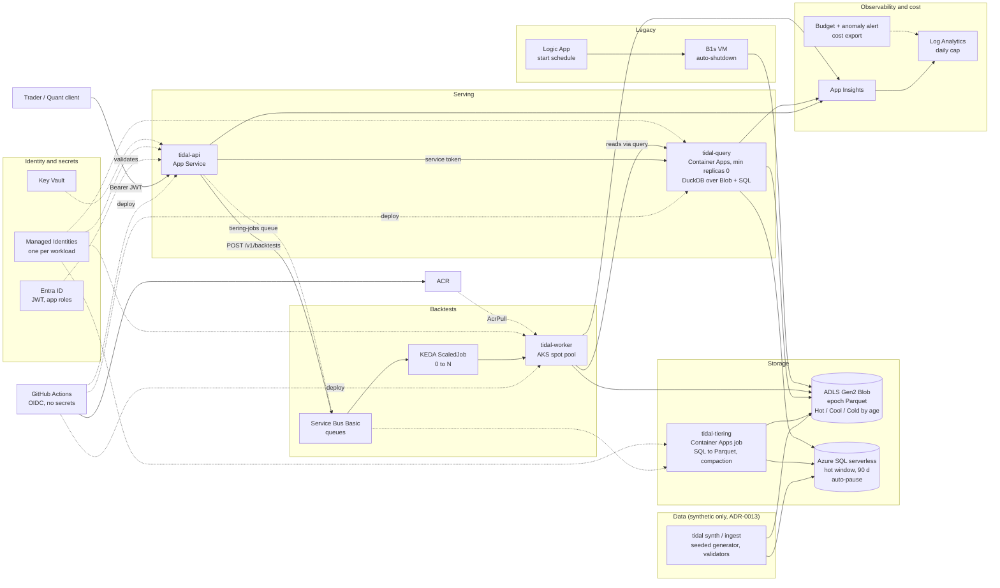

# Tidal architecture (dev environment, as defined in `infra/terraform/envs/dev`)

Nothing here has been deployed to Azure yet. The diagram shows what the Terraform and Helm code in this repository
describes. Components are taken from `infra/terraform/envs/dev/*.tf` and `deploy/`.

